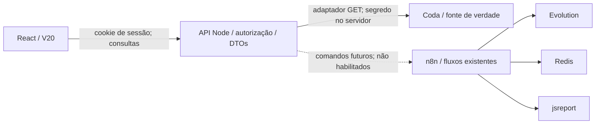

# FUNIX — arquitetura do primeiro incremento

Data: 21/10/2026, America/Sao_Paulo. Estado: IMPLEMENTADO em desenvolvimento; não HOMOLOGADO.

## Escopo e autoridade

O pedido da direção governa o trabalho. A V20 define UX/UI; o guia define o objetivo funcional; o ERP define dados e regras observadas. Os arquivos institucionais 00–10 são contexto, sem conversão automática em requisitos. O registro FUNIX_REGISTROS_VIVOS.md não foi fornecido. Não houve mudança no ERP, workflows ou configurações produtivas.

GUIA_MESTRE e PROMPT_DE_PARTIDA foram lidos integralmente. A V20 foi aberta em Chromium, desktop 1440×960 e celular 390×844, incluindo abas, listas, colapso, retorno e interior. O shell efetivo tem 520 px no desktop. A ordem interna visual observada é Chat, Diagnósticos, Mapa; a enumeração no guia não autoriza trocar a navegação aprovada.

## Ambiente VERIFICADO

- Checkout existente: React 19, TypeScript 6, Vite 8, Node 24.19/npm 11.9. Nenhum backend de negócio anterior no checkout.
- Repositório remoto privado Funix-CentroReparacaoAutomotiva/funixapp, metadados acessíveis pelo conector GitHub. Na inspeção, repositório remoto com tamanho 0 e checkout local sem commits; não foi feito push.
- Superhuman Docs permite leitura do documento Funix, ID 2zsjI-nqWr. As consultas da sessão não conferem uma credencial ao processo Node.
- n8n acessível pelo conector, quatro workflows PROD ativos com execuções registradas. Detalhes em INTEGRACOES.md.
- Runtime sem secrets, variáveis de integração ou identidades de saída configuradas. Política de rede restrita a destinos de desenvolvimento; estado de enforcement do serviço reportado como unknown. Coda/Evolution/n8n privados não estão provisionados como destinos para este backend.
- Não foi presumido acesso direto a Evolution, Redis, jsreport ou Imagine.io.

## Desenho técnico

DECISÃO TÉCNICA REVERSÍVEL: conservar stack local e acrescentar BFF Node com módulos nativos. Não introduzir outro banco, fila ou framework servidor para esta fatia de leitura. Não migrar ERP, copiar engine financeira ou publicar workflow.

Os DTOs ficam em shared/contracts.ts; o adaptador traduz IDs de coluna auditados em dados de apresentação. O frontend não recebe token de Coda nem usa ferramentas do chat como dependência implícita. As respostas não inventam valores para campos ausentes. Estados indisponível, vazio, sessão expirada e erro de integração são distintos.

## Primeiro incremento

- Navegação compacta Conversas/Funil/Veículos; Quadro/Lista; colapso; rotas por IDs; retorno com contexto.
- API somente leitura para listar e abrir Atendimentos e Experiências. Busca paginada, sem baixar todas as linhas a cada tecla.
- Login de desenvolvimento com senha configurada no servidor, cookie HttpOnly e SameSite, expiração, limite de tentativas, rejeição de métodos de mutação. Esse acesso local de operador único não constitui identidade corporativa homologada.
- Conversas, mensagens, escrita de diagnóstico, envio, PDF, agendamento e drag-and-drop de estados ficam indisponíveis até seus contratos seguros. O Copiloto começa por consulta/navegação explícita; não simula inteligência, áudio ou ações.
- Credencial ausente gera erro explícito; não há fallback para dados V20. Fixtures sintéticas são exclusivas dos testes.

## Limites e evolução

A conexão REST do processo Node ainda precisa ser provisionada e testada com credencial de menor privilégio e rede autorizada. API oficial Coda e conector Superhuman podem diferir na serialização e no identificador de views; a suíte isolada prova comportamento do código, não compatibilidade remota definitiva.

Antes de implantação: escolher hospedagem/HTTPS/identidade e papéis com a direção; sessão persistente e controle distribuído conforme a topologia; auditoria e monitoramento; testes em cópia autorizada. Não expor o servidor local à Internet. Não habilitar writes via variável de configuração genérica.

## Marcos verificáveis

| Marco | Resultado | Aceite |
|---|---|---|
| 0 — descoberta | Schemas, fórmulas, views e workflows datados | Separar fatos, protótipos e lacunas; zero mutações produtivas |
| 1 — consulta | V20 + BFF, Funil e Acompanhamento de leitura | Login; busca real; paginação; abrir X e voltar; falha explícita |
| 2 — contexto | Atendimento com mapa/diagnósticos reais | Contratos auditados; troca de registro coerente; sem mistura de clientes |
| 3 — comunicação | Chat N:N e escopo de mensagens | Conta de teste; mensagem uma vez; status real; desambiguação |
| 4 — comandos | Orçamento/agendamento/OS/entrada/saída | Cópia segura; idempotência; concorrência; recuperação; aprovação |
| 5 — Copiloto | Consulta contextual e ferramentas autorizadas | IDs reais; ambiguidade; fuso local; limites de mutação |
| 6 — piloto | Operação gradual com rollback | Homologação de direção/operadores; permissões e observabilidade |

O marco 1 está implementado para validação local, com integração contínua ainda bloqueada pelo provisionamento. Nenhum marco posterior está concluído ou homologado.
