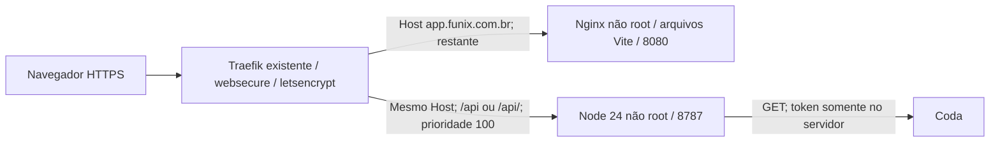

# Implantação FUNIX na Hostinger

> Histórico da preparação da versão Coda. Para o MVP Comercial do PR #10, seguir [PUBLICACAO_MVP_COMERCIAL.md](PUBLICACAO_MVP_COMERCIAL.md): SQLite persistente em `/data`, sem Coda ativo e deploy exclusivamente manual. As instruções antigas abaixo sobre habilitar deploy por push, ausência de banco/volume e rollback sem migrações não se aplicam ao Comercial. Não reinstalar o bootstrap numa VPS já preparada.

Estado: preparação para revisão; implantação real não executada. A VPS não foi acessada e DNS, regras efetivas do Traefik e credenciais remotas não foram verificados nesta etapa.

## Arquitetura



Não há portas publicadas no host, Docker socket montado no aplicativo, banco novo ou alterações nos serviços existentes. Ambos os contêineres entram na rede externa `traefik_default`. Os nomes de routers/services têm prefixo `funixapp-`.

Vite só faz o build. A API mantém `/api` integral: não há StripPrefix. O frontend usa URLs relativas `/api`, e a origem fixa do backend é `https://app.funix.com.br`. Cookies são Secure/HttpOnly/SameSite=Strict. Nginx tem fallback da SPA para rotas do aplicativo; `/api` e assets inexistentes não recebem HTML por engano.

O Compose limita API a 384 MB/0,75 CPU e web a 128 MB/0,50 CPU, além de PIDs e logs. São limites iniciais, não uma medição da capacidade livre da VPS. Os arquivos de sistema são somente leitura e processos não usam root. Sem volumes de dados do aplicativo.

## Pré-requisitos a conferir pelo administrador, após autorização

- Ubuntu amd64 (`uname -m` = `x86_64`); as imagens publicadas têm plataforma `linux/amd64`.
- Docker Engine e **Compose >= 2.30** (`format: raw` no env_file e `up --wait`). Não é necessário instalar Node na VPS.
- Rede existente `traefik_default`; Traefik com Docker provider e rede acessível, entrypoint `websecure` e resolver `letsencrypt`. O projeto não modifica esses componentes.
- Portas 443 e, se o desafio ACME existente usar HTTP, 80 acessíveis segundo a configuração atual. Não alterar o método de desafio sem revisar o Traefik existente.
- DNS A `app.funix.com.br` para a VPS; nenhum AAAA incorreto ou router concorrente para esse Host. Em Cloudflare com proxy, usar TLS **Full (strict)** e conferir compatibilidade do desafio ACME existente; Flexible é incompatível com a origem HTTPS esperada. Não mudar outros registros.
- Não existir outro projeto Compose com o nome `funixapp`.
- GitHub Actions permitido, packages privados no GHCR e permissão do workflow para publicar os packages do repositório.

## Configurações no GitHub

Workflow: `.github/workflows/funix.yml`. Actions de terceiros estão fixadas por SHA, resolvidas dos releases v4/v3/v6 durante a preparação.

Criar Environment **production**, limitado à branch `main`. Para atualização automática após autorização, não exigir aprovação a cada execução; se desejar aprovação por execução, configurar required reviewers e aceitar esse passo manual.

| Nome | Tipo/local | Finalidade |
|---|---|---|
| `FUNIX_DEPLOY_ENABLED` | **Repository Variable**, inicialmente `false` | `true` habilita o job da VPS; deixar ausente também bloqueia. Não criar apenas como variável do Environment, pois a condição do job é avaliada antes de acessá-lo |
| `FUNIX_VPS_HOST` | Variable do Environment production | IP/hostname de SSH da VPS; não é o domínio web por trás do proxy Cloudflare |
| `FUNIX_VPS_PORT` | Variable do Environment production | Porta SSH; padrão 22 |
| `FUNIX_VPS_SSH_KEY` | Secret do Environment production | Chave privada dedicada Ed25519, correspondente à chave pública com comando forçado abaixo |
| `FUNIX_VPS_KNOWN_HOSTS` | Secret do Environment production | Linha(s) completas do known_hosts para o host/porta corretos, conferidas com o fingerprint no console Hostinger |
| `GITHUB_TOKEN` | Automático | `packages: write` apenas no job publish; não criar PAT de escrita como secret |

Nunca adicionar senha FUNIX ou token Coda ao workflow. Eles ficam somente na VPS. Manter packages GHCR privados, vinculados ao repositório; confirmar isso após a primeira publicação. Proteger `main` e revisar mudanças no workflow antes de merge.

O pipeline roda testes/builds em PRs, mas só publica imagens em `main`. Cada imagem recebe tag do commit e o deploy usa o **digest**, não `latest`. O job SSH não recebe Docker socket, token de Coda, senha do app ou comando de shell livre. A atualização é serializada no GitHub e também por flock na VPS.

## Preparação da VPS — instalador inicial

Usar o [procedimento de instalação inicial](INSTALACAO_INICIAL_HOSTINGER.md):
três comandos baixam o código privado e executam o instalador revisado, com
credenciais por prompts. Ele configura somente os caminhos FUNIX e o usuário
restrito, sem iniciar contêineres ou habilitar deploy. Não executar a antiga
sequência manual em paralelo ao instalador.

## Ativação mínima

1. Revisar e integrar esta alteração em `main`, mantendo `FUNIX_DEPLOY_ENABLED=false`. Isso testa e publica as imagens; **não acessa a VPS**.
2. Após autorização da direção, conferir os pré-requisitos e executar o instalador inicial documentado. Cadastrar variables/secrets do GitHub e confirmar leitura dos packages pela VPS.
3. Mudar a Repository Variable `FUNIX_DEPLOY_ENABLED` para `true`. Essa mudança, sozinha, não dispara deploy.
4. Executar o workflow manualmente na `main` com **deploy=true**, ou fazer o próximo push em `main`. Os seguintes pushes farão teste → imagens GHCR → atualização exclusiva FUNIX.
5. Conferir `https://app.funix.com.br`, `/api/ready` e `/release.json`. O workflow verifica HTTPS e a mesma revisão na API/web. Entrar no navegador para validar cookie Secure e leitura autorizada; não colar a senha em comandos de CI.

O administrador precisa reinstalar manualmente `compose.yaml`, `funix-deploy` e `funix-ssh` quando esses arquivos forem alterados futuramente. O Actions atualiza imagens, não substitui arquivos root por conteúdo recebido por SSH. Essa separação mantém o alcance da chave restrito ao projeto aprovado.

## Saúde, falhas e rollback

- `/healthz`: Nginx responde; Docker e Traefik o verificam.
- `/api/health`: processo vivo; informação mínima sobre presença de configuração Coda.
- `/api/ready`: senha configurada e API pronta; inclui revisão. **Não comprova conectividade com o Coda**, pois não deve consultar produção a cada health check.
- Startup de produção recusa senha inválida ou origem não HTTPS. Os health checks não recebem ou imprimem credenciais.
- Atualização espera saúde dos dois serviços. Se `up --wait` falhar, tenta restaurar o par de imagens anteriormente saudável. Na primeira instalação sem anterior, para somente os dois serviços FUNIX. Falha em baixar imagens preserva o par em execução.
- Falha de DNS/TLS/roteamento na verificação pública é separada de falha dos contêineres: o workflow falha, mas não faz rollback automático por um problema que pode ser externo. Corrigir a infraestrutura ou executar o rollback abaixo.

Rollback administrativo (não altera outros projetos):

```bash
sudo /usr/local/sbin/funix-deploy rollback
# Ou uma revisão já implantada com sucesso:
sudo /usr/local/sbin/funix-deploy rollback SHA_DE_40_CARACTERES
```

Também é permitido `ssh funix-deploy@HOST rollback` usando a chave dedicada e host verificado. O script seleciona ambos os digests registrados em `/var/lib/funix/releases/`, espera saúde e atualiza o estado. Não há migration de banco a reverter. Não executar `docker system prune`, `compose down` nem comandos globais: o projeto não precisa deles. Manter os digests de releases anteriores no GHCR e suas permissões de leitura.

Logs operacionais da atualização ficam em `/var/lib/funix/deploy.log`, root 0600; não imprimir env/configuração expandida ao diagnosticar. Para impedir que o próximo push reaplique uma versão após rollback, pausar `FUNIX_DEPLOY_ENABLED` e reverter/corrigir o commit na `main`. Uma revisão já registrada não pode ser associada silenciosamente a outros digests: rebuild diferente do mesmo commit exige novo commit ou rollback para release existente.

## Limitações que permanecem

- Sessões e limitação de tentativas vivem na memória. Atualização/restart pede novo login; executar uma única instância da API. Não foi introduzido banco/Redis adicional.
- O limitador atual usa o endereço do peer. Atrás do Traefik, tentativas podem compartilhar o limite de oito falhas por 15 minutos. Não passamos a confiar indiscriminadamente em X-Forwarded-For. Validar esse comportamento com a equipe antes de uso amplo; autenticação nominal continua etapa futura.
- Estar em HTTPS não transforma esta versão em comercial operacional completo. Coda REST, Histórico, comunicação e comandos mantêm seus limites documentados.
- Na rede Traefik compartilhada, outros contêineres dessa rede podem alcançar as portas internas. O aplicativo exige autenticação, mas isso não equivale a isolamento entre serviços hostis; não foi modificada a rede dos serviços existentes.
- Limite inicial de memória/CPU não comprova capacidade livre da VPS. Validar consumo e resposta no piloto. A troca de um único par de contêineres pode causar breve indisponibilidade; não é uma estratégia sem interrupção.
- Instalação real, certificado, Cloudflare, regras efetivas do Traefik, packages/SSH e leitura Coda precisam de verificação após autorização.

## Validação da preparação

Ver `VALIDACAO_IMPLANTACAO.md` para resultados reais e limites. O CI repete `npm run check`, testes de recuperação/restrição do deploy, construção das duas imagens e smoke tests dentro de contêineres não root, sem produção.

