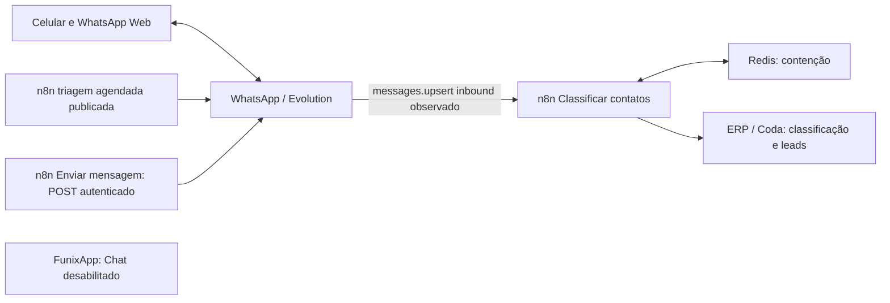
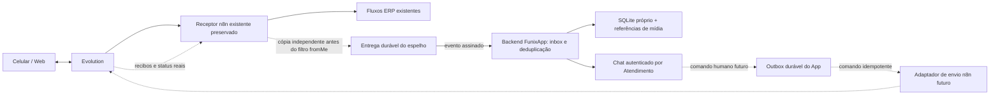

# WhatsApp e Chat — descoberta técnica (Issue #50)

Data: **05/11/2026 (America/Sao_Paulo)**. Escopo: descoberta em leitura e proposta para revisão; nenhuma integração ativada.

Base inspecionada: `main`, commit `8e9d337` (obtido por `git fetch origin main` em 05/11/2026). Branch `docs/issue-50-whatsapp-discovery`, worktree independente. Referência: [Issue #50](https://github.com/Funix-CentroReparacaoAutomotiva/funixapp/issues/50).

## 1. Conclusão e qualidade da evidência

É possível desenhar o incremento de leitura, mas **a ativação de leitura real ainda depende de evidências**: configuração atual de distribuição de eventos, modalidade/versão da Evolution, cobertura do celular/Web, critério de Atendimento aberto e transporte durável da cópia. Envio permanece bloqueado até idempotência durável e reconciliação comprovadas. Este relatório não autoriza alteração produtiva.

Legenda usada neste documento:

- **Confirmado por código**: observado na base acima; não comprova o runtime instalado.
- **Confirmado em ambiente (histórico, 21/10)**: evidência registrada em [INTEGRACOES.md](INTEGRACOES.md), sem revalidação nesta sessão.
- **Pendente de evidência**: não verificado ou depende de decisão/teste futuro.
- **Proposta**: contrato sugerido; não descreve funcionalidade existente.

Não há ferramenta/conector n8n ou Evolution disponível nesta sessão. Nenhuma chamada direta a esses serviços foi realizada. Acesso ao GitHub permitiu consultar Issue #50, seus comentários (nenhum retornado), `main` e metadados/arquivos da PR #49. Nenhuma conversa, execução com payload pessoal, credencial, banco instalado ou VPS foi consultado. O ambiente de desenvolvimento disponível não estabelece acesso aos serviços produtivos.

### Fontes e constatações

| Evidência | Classificação | Consequência |
|---|---|---|
| `server/app.ts`, `createRequestHandler`, `/api/health`: `messages:false`; autenticação de sessão e validação de Origin nas escritas | Confirmado por código | Não habilitar capability apenas porque há UI |
| `src/App.tsx`: Chat/compositor indisponíveis; `src/ui.tsx`: `ChatRail` sem ações reais | Confirmado por código | Reaproveitar experiência V20 sem mensagens fictícias |
| `server/atendimentos.ts`: UUID próprio; `normalizePhone` aceita somente `+` seguido de 8–15 dígitos válidos; valores ambíguos resultam em null | Confirmado por código | Não acrescentar DDI arbitrário nem usar telefone como identidade exclusiva |
| Mesmo módulo: criação com telefone obrigatório; não há seleção de Atendimento aberto por conversa | Confirmado por código | Precisar de resolução explícita e operação transacional específica |
| `shared/contracts.ts`: fases comerciais; não há contrato explícito de ciclo aberto/encerrado para Chat | Confirmado por código | Não equiparar silenciosamente fase comercial a encerramento |
| `server/migrations.ts`: sequência até V13; `server/database.ts`: FK, transações e backup via API SQLite | Confirmado por código | Próxima migração precisa considerar merges concorrentes; nunca fixar V14 antecipadamente |
| `server/backup.ts`: utilitário de backup com origem read-only | Confirmado por código | Existência do utilitário não comprova rotina de backup/restauração em produção |
| Cadeia Evolution → n8n → ERP, com mesmo número no celular | Declaração da direção na Issue #50 | Preservar cadeia; cobertura técnica do celular ainda pendente |
| V1.0 §§4–6 e 11, CH01–CH09 | Requisito documental | Histórico novo desde ativação; Atendimento obrigatório; cinco formatos; estados verdadeiros; IA separada |

A [especificação unificada V1.0](especificacao-v1.0/originais/FUNIX_ESPECIFICACAO_UNIFICADA_V1_0_PARA_CONFERENCIA.md) registra que a síntese não foi homologada integralmente. A Issue #50 é a autorização atual para descoberta, superando somente o impedimento histórico de trabalhar WhatsApp; não autoriza implementação. M3 será bidirecional ao final, incluindo texto/foto/áudio/vídeo/documento. Uma primeira PR de inbox não conclui M3. M4 assistivo e Copiloto de Diagnósticos ficam fora desta entrega.

## 2. Inventário histórico e lacunas atuais

Todos os dados da tabela são **confirmados em ambiente em 21/10, conforme INTEGRACOES.md**; situação publicada em 05/11 está **pendente de evidência**.

| Workflow / ID | Publicado | Draft | Contrato observado |
|---|---|---|---|
| Classificar contatos / `21wpOido7t5OHb7i` (49 nós) | `e07fec83-208c-4643-b21c-7200beec0d84` | `fc266800-a699-441a-aa29-f5e2221f39c4` | POST, `messages.upsert`, `fromMe=false`, ID e JID físico; normalização, `fx_UUID`, Redis, consulta/criação Coda; saída HTTP não especificada no inventário |
| Enviar mensagem / `22tutH8gEcX6bNoe` (5 nós) | `351ed7fe-3b60-426e-afc8-718dfe627172` | `60e2f4fc-07ee-41ea-8e46-34a8054fcf12` | POST autenticado por header; `{telefone,mensagens:[]}` → Evolution `{number,text}` em `/message/sendText/funix_comercial`; resposta `{ok,solicitadas,aceitas}`; verificação de `key.id`/`key.fromMe` |
| Preparar dados PDF / `EYGYfWf9rNeLsueT` (4 nós) | `c6738874-b9fe-42d7-bca4-1040fb84876d` | `a96d0216-2a9b-4c16-8519-2f907d79cdce` | JSON, Redis TTL 300s; não integra Chat hoje |
| Gerar PDF / `vE1QlFYjOcjEoMZx` (5 nós) | `d87efefd-b4d1-43a4-82d1-381412ee9e39` | igual | GET → Redis → jsreport → binário; controle externo não auditado |

Instância Evolution referenciada: **`funix_comercial`**, não um UUID técnico confirmado. IDs internos da instância, versão da Evolution, integração Baileys/Cloud API, eventos globais/por instância, URL receptora efetiva, filtros, quantidade de destinos, subworkflows e versões atuais são **pendentes**. Não se pode concluir que todo evento chega a todos os workflows. O inventário comprova entrada no classificador e chamadas de envio, não a topologia completa do webhook Evolution.

A triagem agendada estava habilitada na versão publicada e desabilitada no draft. Ela inclui contenção Redis e proteções próprias; **não publicar drafts para instalar o espelho**. O envio simples não tinha idempotência persistente de comando comprovada. Sucesso do workflow ou recibo de aceitação não comprova entrega/leitura.

Para atualizar este inventário: acesso read-only a metadados e grafos publicados/drafts ou export sanitizado datado, sem credenciais, URLs com tokens, conteúdo de mensagens ou dados de execução. Comparar IDs/versionIds, estado ativo, filtros de evento, contratos e referências a subfluxos. Configuração de webhook deve ser fornecida com destino pseudonimizado e controles descritos. Não usar execuções pessoais como amostra contratual.

## 3. Fluxos atual e proposto

Fluxo atual, conforme evidência histórica e declaração da direção (a ligação efetiva do receptor ainda precisa ser revalidada):



Proposta, sujeita a revisão e autorização posterior de infraestrutura:



A cópia deve ocorrer **antes** do filtro `fromMe=false` e antes de regras que descartem candidatos/contatos; sem isso, celular, saídas e certas entradas ficam invisíveis. Se o receptor atual não receber esses eventos, será necessária outra distribuição homologada, sem substituir o destino existente. Não presumir suporte a múltiplos destinos na Evolution.

O desenho de entrega durável não está implementado: escolher após conhecer o receptor atual e sua capacidade de persistir/reprocessar. Falha do App não pode bloquear ERP/triagem; sucesso do ERP não pode descartar cópia ainda não persistida. Um POST síncrono adicional sem fila/recibo durável não atende essa condição. Redis de locks não equivale a fila durável. Nenhuma alteração desses fluxos faz parte desta PR.

## 4. Identidade, Atendimento e fronteira ERP (proposta)

- Chave de conversa: `(instance, remoteJid)`; chave de mensagem: `(instance, remoteJid, messageId)`, sempre incluindo escopo da instância. `instance` será alias local vinculado ao ID real verificado; não aceitar instância arbitrária do payload.
- Manter JID original opaco e aliases verificados. `@lid` não é telefone e não deve ser convertido por remoção de sufixo; somente mapear para JID telefônico com evidência do provedor. Não fundir conversas por nome, foto, últimos dígitos ou telefone possivelmente reciclado. Registrar origem e revisão da equivalência; conflitos vão para resolução humana.
- Escopo inicial: conversas individuais. Grupos, broadcast, status e eventos de protocolo não viram leads; registrar apenas metadado técnico mínimo de descarte. Cobertura real de JIDs depende da versão detectada.
- Evento inbound persistido após o marco de ativação: buscar vínculo da conversa e sua validade para Atendimento aberto. Sem vínculo, usar telefone E.164 verificado como candidato de contexto. Um aberto inequivocamente associado permite vínculo; múltiplos ou identidade incerta → `vinculo_pendente`. Zero abertos → criar **um Atendimento local** e vínculo na mesma transação de processamento idempotente.
- O código atual exige telefone e abre transação dentro de `create`. A implementação deverá extrair operação interna reutilizável na transação do Chat, preservando inicialização financeira. Não encadear transações `BEGIN` nem deixar mensagem/criação/vínculo parcialmente confirmados. Serializar resolução por conversa e revalidar candidatos no commit para duas entradas simultâneas não criarem dois Atendimentos.
- Sem telefone confiável (ex.: LID não resolvido), guardar evento na inbox técnica pendente; não criar telefone fictício. Sem regra aprovada de “aberto”, suspender criação/vínculo automático. A direção deve definir encerramento, reabertura, rejeitados e transferidos ao ERP; as seis fases atuais não resolvem isso.
- `vinculo_pendente` aparece como tarefa de resolução, sem abrir Chat de mensagens órfão. Operador escolhe Atendimento ou confirma criação; usar revisão, autorização e auditoria. Corrigir vínculo não deve mover silenciosamente histórico antigo. Uma conversa pode atravessar Atendimentos sucessivos: atribuição por mensagem e períodos de vínculo preserva o contexto, sem levar toda a conversa anterior ao novo Atendimento.
- `fromMe=true` externo não abre automaticamente Atendimento nem cria lead. Guardar como pendência técnica se faltar vínculo; distinguir origem `app`, `external` ou `unknown`. `fromMe` sozinho não separa celular, Web, triagem e outro cliente da API.
- n8n mantém classificação, “Não gerar lead”, candidato, reservas e criação ERP. App não cria linha ERP ao receber mensagem. Primeiro contato pode gerar **um local e um ERP**, intencionalmente em sistemas distintos; nunca dois no ERP pela adoção do Chat. Correlação opcional por `fx_UUID`/referência externa verificada, sem usar IDs Coda como PK local, importar Atendimentos legados ou consultar cadastros formais.
- Preferência “Não gerar lead” do ERP não implica descartar Chat; a política para contatos excluídos/candidatos deve ser homologada. Sem associação formal disponível, marcar correlação ERP desconhecida. Não reaproveitar automaticamente este espelho para transferência M2; eventual envio ao ERP precisa conciliar criação já existente antes de nova abertura.

## 5. Contrato de eventos normalizados (proposta v1)

Nomes abaixo pertencem ao adaptador futuro; **não são nomes garantidos de eventos Evolution**. Datas UTC ISO 8601; exemplos inteiramente sintéticos, com aliases sem telefone real.

```json
{
  "schemaVersion": 1,
  "eventId": "evt-sintetico-001",
  "type": "message.upsert",
  "instance": "instancia-piloto",
  "occurredAt": "2026-11-05T13:00:00Z",
  "message": {
    "remoteJid": "contato-sintetico@lid",
    "messageId": "msg-sintetica-001",
    "fromMe": false,
    "origin": "unknown",
    "kind": "text",
    "text": "Mensagem sintética para ensaio",
    "media": null
  },
  "correlation": {"commandId": null, "erpEventRef": null}
}
```

| Campo/regra | Contrato |
|---|---|
| `schemaVersion` | Inteiro suportado; versão desconhecida rejeitada, sem interpretação parcial |
| `eventId` | ID estável do evento na origem/relay, preservado entre retries; único por instância. Se provedor não trouxer ID de evento, relay gera determinístico por identidade, tipo e revisão/status, sem depender do instante de recebimento |
| `type` | `message.upsert`, `message.status`, `message.deleted`, `connection.changed`; mapeamento bruto → normalizado depende de export sanitizado |
| `occurredAt` / `receivedAt` | Primeiro é instante informado pelo provedor; segundo gerado pelo App. Preservar precisão disponível e marcar ausência/inconsistência; não inventar ordem causal por relógio |
| Mensagem | `remoteJid`, `messageId`, `fromMe`, `kind` obrigatórios no upsert. `kind`: text/image/audio/video/document/unsupported; corpo conforme tipo. Origem só `app` com correlação comprovada |
| Mídia | Referência opaca, MIME declarado, bytes se conhecido, legenda/nome opcionais; nunca URL livre do remetente nem base64 ilimitado no envelope |
| Status | Identidade da mensagem, estado normalizado `accepted/delivered/read/failed` e instante; guardar status bruto sanitizado para diagnóstico. Conexão usa estado e motivo técnico, sem mensagem |
| Correlação | `commandId` somente se verificável; `erpEventRef` opcional. Não confiar em associação de Atendimento enviada pelo cliente externo |

Duas deduplicações duráveis: inbox `UNIQUE(instance,eventId)` e mensagens `UNIQUE(instance,remoteJid,messageId)`. Mesmo evento/mesmo digest → devolver recibo existente; mesmo ID/corpo divergente → conflito/quarentena, sem sobrescrever mensagem. Atualizações legítimas usam evento distinto; edição/apagamento mantêm identidade e revisão, sem recriar mensagem nem prometer suporte antes de validar o provedor.

### API de entrada e leitura

- `POST /api/integrations/whatsapp/events`: rota máquina a máquina dedicada; autenticação por assinatura, sem cookie do operador. `202 {eventId,receiptId,state:"persisted"}` apenas depois do commit durável da inbox. Repetição válida retorna mesmo recibo. `400/413/415/422`: erro permanente de contrato; `401/403`: autenticação; `409`: ID divergente; `429/503`: retry com backoff e jitter preservando eventId. Quarentena e alerta após tentativas limitadas; reprocessamento manual rastreável.
- `GET /api/chat/conversations?cursor=...`, `GET /api/atendimentos/:id/messages?cursor=...`: sessão autenticada, paginação por cursor estável, somente mensagens autorizadas vinculadas; pendências em projeção separada sem conteúdo de Chat. Não confundir leitura no App com recibo WhatsApp de lida.
- `POST /api/chat/conversations/:id/link`: escolha humana, revisão e idempotência; sessão e Origin existentes; conflito `409`. Persistir quem/quando/por quê, sem conteúdo em logs.
- Proposta de polling paginado inicial, conexão e atraso explícitos; SSE só se necessário. Mostrar “sem mensagens desde ativação”, “vínculo pendente”, “conexão desconhecida/desconectada” e “mídia indisponível” conforme evidência; falta de evento não prova canal conectado.

Inbox permite status antes da mensagem: armazenar pendente pela chave de mensagem e reconciliar quando upsert chegar. UI ordena por instante do provedor + sequência local de desempate; não usa ordem de chegada para regredir estado. Reprocessamento após reinício aplica eventos sem duplicar Atendimento/mensagem. Marco de ativação por instância exclui importação de histórico anterior; registrar eventuais lacunas em vez de fabricar mensagens. Eventos sem data confiável exigem revisão do adaptador, não descarte silencioso.

## 6. Envio idempotente e estados (proposta, etapa posterior)

```json
{
  "commandId": "2e58f9a2-d5ec-4b6b-9614-5861e3b6e504",
  "conversationId": "conversa-sintetica-001",
  "atendimentoId": "b7c96f62-e7b4-429c-8a14-d7eeb062ef42",
  "linkRevision": 3,
  "content": {"kind": "text", "text": "Resposta sintética revisada"}
}
```

`POST /api/atendimentos/:id/message-commands`, `Idempotency-Key: <commandId>`, sessão/Origin e confirmação humana pelo Enviar. Destino e instância derivam do vínculo autorizado no backend, não de um telefone livre no body. Validar elegibilidade do canal/janela, conexão, revisão e mídia antes de reservar comando. Resposta `202 {commandId,state:"sending"}` significa persistência local, não aceitação do provedor. `GET /api/chat/message-commands/:commandId` permite recuperar após timeout. Mesmo ID/digest retorna comando existente; mesmo ID/conteúdo diferente retorna `409`.

| Estado interno / UI | Evidência e transição |
|---|---|
| `sending` / enviando | Outbox persistida; lease de worker impede dois dispatches concorrentes |
| `accepted` / aceita pelo provedor | Recibo real com identidade de mensagem válido; não implica entrega |
| `uncertain` / resultado incerto | Timeout, desconexão após início da requisição ou crash sem recibo; bloquear reenvio automático |
| `failed` / falhou | Rejeição definitiva que demonstre ausência de envio; erro ambíguo permanece incerto |
| `delivered` / entregue | Evento real correlacionado à mensagem |
| `read` / lida | Evento real correlacionado; não inferir por abertura do Chat |

Status atrasado de aceita/entregue não regride lida; falha conflitante após entrega fica registrada para revisão, sem apagar evidência. Ausência de recibo de leitura pode refletir configurações do WhatsApp; não impor timeout que transforme ausência em falha.

**Barreira essencial:** idempotência só no SQLite do App não resolve crash entre envio Evolution e gravação do recibo. Adaptador n8n futuro precisa receber comando estável e manter registro durável com digest, reserva, resultado e consulta. O contrato histórico `{telefone,mensagens[]}` não oferece essa garantia e não deve ser chamado cegamente em retry. Preferir um comando por mensagem; lotes exigiriam recibo/idempotência por item.

Mesmo com ledger no n8n, se Evolution não suportar chave idempotente, permanece janela entre aceitação externa e persistência do recibo. Marcar incerto e reconciliar por ID/consulta técnica autorizada ou intervenção humana; nunca prometer exactly-once. Não correlacionar por texto/telefone/horário parecidos. Echo `fromMe` correlacionado pelo messageId atualiza a mesma mensagem; echo sem correlação é mensagem externa, sem duplicar por chave. Worker retomado após lease expirada não dispara de novo comando possivelmente enviado.

Reenvio manual de falha comprovada cria novo comando ligado ao anterior. Comando incerto requer reconciliação antes de oferecer nova tentativa. Novas conversas por telefone só após verificar regras da modalidade detectada; mensagens prontas somente preenchem compositor editável.

## 7. Mídias, segurança e recuperação (proposta)

Texto, foto, áudio, vídeo e documento precisam ser homologados em entrada/saída para concluir M3. Transporte binário separado do evento: referência do provedor → retrieval exclusivamente backend → arquivo privado/quarentena → referência interna autorizada. Anexo de saída faz upload autenticado e validação antes da criação do comando; não enviar arquivo enquanto estiver incompleto/em análise.

- **Limites propostos para ensaio**, ainda sujeitos a validação: envelope 256 KiB; texto 16 KiB; imagem 10 MiB, áudio 16 MiB, vídeo/documento 20 MiB; download com timeout 30s e streaming com teto de bytes. Aplicar o menor limite entre App e provedor confirmado. Bloquear arquivo excedente antes de alocar todo o conteúdo; manter mensagem com motivo da indisponibilidade. Conferir MIME por conteúdo, nome escapado, extensão e hash, sem executar anexos; rejeitar conteúdo ativo em preview e servir documento como attachment. Não prometer codec universal; disponibilizar download autorizado como alternativa.
- Não buscar URL do payload diretamente. Resolver mediaRef por API/host fixos configurados no servidor; allowlist de host/esquema/porta, bloqueio de endereços locais/privados/link-local/metadata, revalidação DNS e de cada redirect (preferencialmente redirects desabilitados). Sem proxy aberto, sem chave Evolution no browser. Se não houver API segura para recuperar/decriptar mídia, marcar pendente, não improvisar acesso.
- Referências externas podem expirar; registrar `available/expired/failed/unsupported`, política de retry limitada e indisponibilidade explícita. Não importar mídias anteriores à ativação. URLs internas curtas ou streaming com sessão e autorização por Atendimento, `no-store`, sem expor caminhos de disco; armazenamento fora da raiz pública/Git, permissões restritas e criptografia/backup definidos na infraestrutura futura.
- **Retenção pendente de aprovação:** volume diário por tipo × tamanho médio × dias, mais cópias de backup, estima armazenamento; tráfego de upload/download e eventual tarifa do provedor estimam custo. Proposta de ensaio isolado: apagar arquivos e conteúdo sintéticos ao encerrar; para piloto real, definir dias de texto/mídia/inbox/backup, quotas e responsável antes de habilitar captura. Expurgo de mídia preserva metadado de expiração e não quebra a conversa; deleção deve alcançar cópias segundo política homologada.
- Transporte TLS; proposta HMAC-SHA256 sobre `timestamp + "." + corpo bruto`, headers de keyId, timestamp e assinatura; comparação constante, janela de 5min e eventId durável contra replay. Retry preserva evento, mas assina timestamp novo. Segredo dedicado/rotacionável, backend e relay apenas, nunca segredo Evolution reutilizado. IP allowlist é complemento, Origin não autentica servidor. Limitar taxa, corpo e tempos antes de parse; normalizador rejeita campos/tipos imprevistos sem registrar payload.
- Logs somente requestId/receiptId, código de erro, contagem, latência e versão do adaptador. Sem texto, telefone, JID, nome, arquivo, URLs assinadas, headers ou tokens; identificadores de correlação de logs devem ser opacos. Métricas: atraso, duplicatas, pendências, falhas de mídia, backlog e estado de conexão, sem dados pessoais.
- ACK só após inbox durável; dedup e projeções na mesma transação local, sem chamada externa durante transação SQLite. Retentativas limitadas, fila de falhas e reprocessamento autorizado por recibo, mantendo IDs. Reinício/crash não perde o evento confirmado. Backups consistentes via API SQLite existente, nunca cópia ingênua de arquivo aberto; ensaio de restauração em banco sintético e consistência com arquivos de mídia. Frequência, RPO/RTO, local seguro e retenção ainda precisam de responsável. Não executar backup/restauração no banco real nesta descoberta.

## 8. Celular, Web e modalidade do provedor

**Modalidade efetivamente detectada nesta sessão: indeterminada.** Evolution e nome de instância não demonstram Baileys nem Cloud API. Não foi lido metadado de integração atual. `fromMe=false` observado no classificador não demonstra ausência desses eventos na Evolution; demonstra apenas filtro do consumidor histórico.

| Modalidade a confirmar | Risco específico | Evidência necessária |
|---|---|---|
| Baileys / dispositivo vinculado | Desconexão de sessão, mudanças de protocolo, lacunas de echo/status/mídia entre dispositivos; continuidade operacional e restrições do serviço | Metadado integration/version sanitizado e ensaio de convivência; não renovar QR nem relincar número para descobrir |
| Cloud API | Janela de atendimento, templates/custos e elegibilidade de coexistência com app dependem da conta/configuração; não presumir que celular continuará utilizável | Modalidade e habilitação de coexistência comprovadas, regras atuais do canal e autorização específica; nenhuma migração de número nesta tarefa |

### Matriz de testes seguros, não executados

Usar primeiro instância/número de teste isolado e contatos consentidos. Qualquer teste no número principal exige autorização pontual do operador, janela, observador e contingência. Não enviar para clientes reais nem ler conversa pessoal.

| Ensaio futuro | Observar com dados sintéticos | Aprovação |
|---|---|---|
| Contato de teste → número: texto e quatro mídias | Upsert, JID/LID, IDs estáveis, arquivo disponível e vínculo local | Um evento lógico/mensagem; nenhuma nova escrita ERP feita pelo App |
| Celular e Web → contato de teste, separadamente | `fromMe`, echo, IDs e cobertura por formato; origem pode continuar unknown | Mensagem aparece uma vez se suportada; lacuna explicitada, sem declarar histórico completo |
| App de ensaio → contato, com celular/Web abertos | Aceitação e eventos delivered/read quando disponíveis; echo e correlação | Mesma mensagem no App; celular/Web continuam operáveis |
| App desconectado, eventos repetidos/fora de ordem, reinício | Retry do relay e inbox; status antes do upsert | ERP continua; replay não duplica mensagem/Atendimento |
| Timeout após envio e crash antes do recibo | Consulta do comando e ledger; lease e incerteza | Nenhum reenvio cego; resultado incerto visível |
| Primeiro contato, um/múltiplos abertos, LID sem alias | Reserva transacional e resolução humana | Nunca Chat órfão nem escolha arbitrária; nenhuma criação ERP adicional pelo App |
| Retrieval expirado/host proibido/arquivo excedente | Estados de mídia e controles SSRF | Mensagem preservada, nenhum acesso indevido |

Não testar queda/desvinculação da Evolution produtiva, desligamento de triagem ou alteração de webhook como forma de validação. Ensaiar falhas em adaptadores/sandbox. Relatório futuro deve separar recebido pelo provedor, recebido pelo relay, persistido no App e visto no dispositivo.

## 9. Riscos, bloqueios e piloto reversível

| Risco | Impacto | Dependência/mitigação |
|---|---|---|
| Substituir webhook ou publicar draft | Interromper classificação/triagem ERP | Grafo/configuração atual sanitizados; cópia independente homologada; nenhuma publicação nesta PR |
| Perder saída do celular/Web | Histórico incompleto e resposta duplicada do operador | Cobertura medida por formato/origem; estado de limitação visível; bloqueia promessa de coexistência completa |
| Retry após timeout | Mensagem duplicada ao cliente | Ledger nos dois lados, recibo, consulta e estado incerto; bloqueia envio |
| Telefone/LID ou múltiplos abertos | Vazamento de conversa ou vínculo errado | Alias comprovado e escolha humana; bloqueia vínculo automático ambíguo |
| Dupla criação ERP | Atendimento operacional duplicado | Consumidor App sem escrita ERP; preservar automações existentes e separar correlação M2 |
| Falha do App propagar ao n8n | Prejuízo à operação atual | Transporte de cópia durável independente; teste isolado e reversão |
| URL/mídia maliciosa e segredo exposto | SSRF, vazamento, indisponibilidade | Resolver referência no backend, limites, autenticação e logs mínimos |
| Acúmulo de mídia/inbox e backup incompleto | Disco cheio ou perda de histórico | Quota, expurgo homologado, métricas e restauração sintética |
| Schema/módulos compartilhados com Copiloto | Regressão ou colisão de migração | PRs pequenas, rebase, atribuição de número só após atualizar main e regressões |
| Modalidade desconhecida | Coexistência, custo e regras incorretos | Metadados de integração e versão; não assumir Baileys/Cloud |

Piloto futuro: (1) validar contratos/assinatura/replay em fixtures e SQLite temporário; (2) validar provedor isolado; (3) direção autoriza instalação da cópia e captura limitada, com data de ativação e escopo de contatos acordado; (4) inbox somente leitura, envio desabilitado, comparar contagens técnicas e continuidade ERP/celular; (5) homologar envio de teste só após barreiras de idempotência. Só então ampliar formatos/escopo. Capturar tráfego real já requer política de privacidade/retenção e autorização, mesmo sem enviar.

Critérios de parada: qualquer alteração no funcionamento ERP/celular, vínculo errado, duplicata, perda de ACK durável, segredo em logs ou crescimento sem limite. Reversão: desabilitar consumo/capability do Chat e a cópia pelo mecanismo aprovado, preservando o caminho ERP original; nenhuma reversão que publique draft ou altere número/sessão. Guardar recibos/eventos já confirmados para diagnóstico restrito; retomar por replay somente dentro da retenção acordada. Rollback não reenvia comandos nem apaga Atendimento/composição/snapshots. A definição e execução do mecanismo de desligamento dependem da futura mudança autorizada, não existem hoje.

## 10. Concorrência e sequência de implementação

PR #49 consultada em 05/11: aberta, branch `feat/issue48-voice-resolution`; altera, entre outros, `server/app.ts`, módulos `server/voice-*`, `shared/voice-*`, `src/VoiceCopilot.tsx`, `src/VoiceReview.tsx` e CSS próprio. Esta descoberta altera **somente este arquivo**, sem mudanças em AGENTS ou Copiloto.

Proposta de isolamento para próximas PRs:

- Novos módulos específicos: `server/chat/{events,inbox,identity,repository,commands,provider,media}.ts`, `shared/chat.ts`, `src/chat/{Inbox,ChatPanel,Composer}.tsx` e testes próprios. Nomes propostos, ainda não criados.
- Tabelas aditivas sugeridas: `chat_events`, `chat_conversations`, `chat_identity_aliases`, `chat_links` (períodos/revisão), `chat_messages` (FK Atendimento após resolução), `chat_commands`, `chat_media`. Inbox técnica pode conter evento ainda sem vínculo; UI não expõe esse conteúdo como Chat. Índices únicos das chaves descritas e receipts/leases de comandos; não alterar tabelas de orçamento/Copiloto para guardar mensagens.
- Integração mínima em `server/app.ts` por delegação de rotas dedicadas, em `src/App.tsx` pela inbox e slot de Chat, e migração central quando necessária. Preservar `CommercialPanel`, `VoiceCopilot`, fluxo de autosave, navegação, safe-area e Copiloto único; não criar segunda IA no `ChatRail`. `src/api.ts` deve sanitizar novos caminhos de IDs nos diagnósticos de erro, se reutilizado.
- Cada frente em branch/worktree próprio; antes de cada PR funcional, fetch/rebase na main, conferir PR #49/sucessoras e negociar apenas pontos compartilhados pelo review. Renumerar migrações não integradas após rebase; nunca editar uma migração já publicada. Não fazer merge da branch do Copiloto nesta branch documental.

| PR futura | Conteúdo | Gate / validação |
|---|---|---|
| 1 — leitura/inbox | Schema/adapter normalizado, assinatura, inbox durável, identidade e resolução de vínculo, inbox UI; nenhum envio | Evidência atual do receptor/modalidade e regra aberto; fixtures sintéticas, concorrência, replays, status fora de ordem, reinício e rollback em SQLite temporário; capability só após habilitação autorizada |
| 2 — envio texto | Outbox/ledger e consulta, incerteza, compositor com envio humano | Contrato remoto idempotente homologado e coexistência; timeout/crash/echo, janela/restrições verificadas; nada de retry cego |
| 3 — mídias e estados | Cinco formatos em ambos sentidos, retrieval/upload seguros, estados reais e expiração | Limites/custo/retenção aprovados, eventos comprovados, SSRF/autorização/quotas e celular/Web por formato; requisito para concluir M3 |
| 4 — mensagens prontas | Textos editáveis, preencher compositor | Nenhum envio automático, isolamento por contexto, estados preservados |
| 5 — comunicação assistiva posterior | Resumo/resposta/preenchimento via Copiloto único | Escopo próprio M4, privacidade e provedor; revisão humana antes de gravar/enviar; coordenação com frente Diagnósticos |

Regressões funcionais futuras: autenticação/Origin, Atendimento manual, múltiplos telefones iguais, navegação Conversas/Funil/Chat/Mapa/Diagnósticos, autosave/revisões, recomendações, emissão/PDF/snapshots e Copiloto existente. Executar `npm run check`, testes de persistência/reinício em arquivos temporários e QA desktop 1440/mobile 390/320 conforme AGENTS, sem abrir banco normal. Smoke deve alternar dois Atendimentos e provar que mensagem, anexo e comando não vazam de contexto. Não habilitar fluxo produtivo por passagem de CI.

## 11. Dados e decisões necessários da direção

1. Export sanitizado ou acesso **read-only** aos grafos publicados/drafts e metadados atuais do n8n: IDs, versões, subfluxos, filtros, schemas de exemplo sintéticos, autenticação descrita sem valores e configuração de distribuição efetiva. Não fornecer dumps de execuções com mensagens.
2. Metadados sanitizados Evolution: versão, modalidade/integration, ID técnico da instância, eventos habilitados, capacidade de entrega/replay/consulta por ID, tratamento LID, formatos e limites, status e expiração de mídia. Não enviar QR, chaves ou conteúdo de sessão.
3. Regra de “Atendimento aberto”, transição entre Atendimentos da mesma conversa, resolução humana de ambiguidades e comportamento para LID sem telefone, candidatos e preferência “Não gerar lead”.
4. Ambiente/número/contatos de teste consentidos; posteriormente autorização pontual para piloto no principal, com responsável, janela, contingência e critérios de parada.
5. Política de retenção, quotas, volume estimado, backup/RPO/RTO e custo permitido; forma de transporte durável da cópia e responsável por sua homologação.
6. Credenciais futuras **somente por canal seguro de secrets**, com privilégio mínimo e separação sandbox/produção; nunca em Issue, PR, chat ou relatório. Não são necessárias para revisar esta proposta.

## 12. Verificação desta entrega

Revisão documental: rastreabilidade das nove perguntas da Issue nas seções 2–10; exemplos sintéticos; distinção de evidência atual, histórica e proposta; diagrama do caminho existente/proposto; plano de testes não executados e dependências explícitas. Verificações executadas: dois exemplos JSON parseados com sucesso, links locais resolvidos, blocos de código fechados e whitespace sem erros. Diff restrito a `docs/WHATSAPP_DISCOVERY.md`; main remota reconferida no mesmo commit-base antes da publicação. `npm run check` e QA funcional não executados: não há alteração de código ou comportamento nesta PR; permanecem obrigatórios para os incrementos funcionais propostos.

Nenhum teste de coexistência, envio, webhook, acesso produtivo, backup real, migração, merge ou deploy foi executado. Testes funcionais/QA de navegador pertencem às PRs de implementação, não demonstram comportamento novo nesta descoberta exclusivamente documental.
