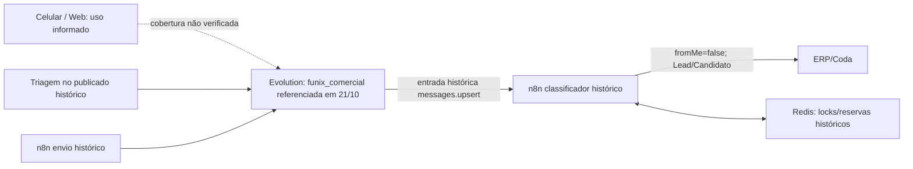
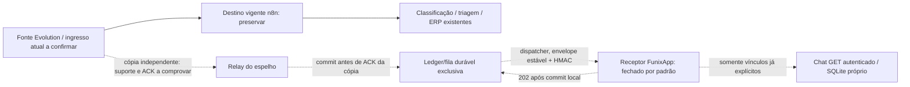

# WhatsApp — validação de topologia e desenho de espelhamento (Issue #62)

Data: **06/11/2026, America/Sao_Paulo**. Base inspecionada: `main` `b40a42fc1aa6abe87c4ff2ec0e581cabb59f4cb1`, com PRs #61/#59 integradas. Branch/worktree próprios: `docs/issue-62-whatsapp-topology`.

Fontes: [Issue #62](https://github.com/Funix-CentroReparacaoAutomotiva/funixapp/issues/62), [inventário de 21/10](INTEGRACOES.md), [descoberta](WHATSAPP_DISCOVERY.md), [base local](WHATSAPP_BASE_LOCAL.md), [Chat read-only](WHATSAPP_CHAT_READONLY.md), [receptor e gates](WHATSAPP_INGEST_READINESS.md).

## 1. Resultado e alcance da validação

**A topologia produtiva publicada não foi validada nesta sessão.** A busca nas ferramentas disponíveis não encontrou conector n8n/Evolution. O contexto atual do ambiente não informa credenciais/variáveis/identidades externas provisionadas para esse acesso. Não foram recebidos exports atuais sanitizados. Isso descreve o acesso desta tarefa, não a existência dos serviços ou de acessos em outros ambientes.

Não foram feitas chamadas aos serviços produtivos, descoberta de hosts, inspeção de arquivos de segredo, busca de sessões autenticadas, consulta de mensagens/execuções/bancos, teste de webhook, ativação do receptor ou operação no celular. Os únicos acessos remotos desta entrega são ao GitHub para Issue/repositório/PR. Não se tentou obter cobertura consultando histórico pessoal.

É possível revisar contratos por código e preparar o desenho condicional abaixo; **não é possível escolher um ponto real de cópia, confirmar cobertura ou autorizar piloto**. Ficam pendentes os exports mínimos da seção 4. Este documento não certifica ambiente instalado, durabilidade do provedor nem ausência de impactos operacionais.

Legenda:

- **Atual por código:** observado no commit-base; não confirma versão/configuração em execução.
- **Histórico:** descrito no inventário de 21/10/2026, sem revalidação atual.
- **Informado pela direção:** requisito/declaração operacional na Issue; não é observação técnica independente.
- **Pendente:** falta evidência suficiente; desconhecido não significa ausente.
- **Proposta/hipótese:** desenho para decisão posterior, ainda não implantado nem homologado.

## 2. Matriz de evidências

| Evidência | Fonte | Verificado ou pendente | Implicação | Decisão necessária |
|---|---|---|---|---|
| Receptor HMAC existe no repositório e fecha sem flag/configuração válidas; `messages=false` | `server/chat/ingest.ts`, `ingest-config.ts`, `server/app.ts`, `.env.example` | Atual por código | Merge não prova deploy nem estado de flag/registro em produção | Não ativar; qualquer estado instalado exige evidência administrativa posterior |
| Registro local e whitelist por chave são gates independentes; startup/primeiro evento não registram instância | `server/index.ts`, `server/chat/repository.ts`, loader | Atual por código | Alias recebido não cria canal ou vínculo | Definir operação administrativa auditável antes de piloto |
| Inbox tem dedup por evento/instância, mensagem por conversa/ID, ACK após commit e leitura por Atendimento | Base/receptor integrados nas PRs #54/#57/#61 | Atual por código; ensaios históricos sintéticos documentados | Não garante entrega até a entrada da inbox nem recuperação upstream | Homologar ledger/cópia durável do relay separadamente |
| Classificador recebia `messages.upsert`, filtrava `fromMe=false`, exigia ID/JID físico e gerava `fx_UUID` | INTEGRACOES, seção classificação | Histórico 21/10 | Um tap depois desse filtro perderia outbound e outros descartes | Obter grafo publicado atual e filtros antes de escolher tap |
| Classificador consultava/criava lead/candidato no ERP e respeitava “Não gerar lead”; contenção Redis | Mesmo inventário | Histórico 21/10 | Espelho não deve repetir o classificador nem criar leads ERP | Preservar esse consumidor como único responsável por tais gravações |
| Triagem agendada habilitada no publicado e desabilitada no draft | Mesmo inventário | Histórico 21/10 | Publicar draft pode alterar operação além do espelho | Comparar publicado/draft sem publicar; planejar diff mínimo em etapa futura |
| Envio simples retornava aceitação `key.id`/`fromMe`, sem idempotência de comando persistente comprovada | INTEGRACOES, seção envio | Histórico 21/10 | Recibo não comprova entrega/leitura nem origem celular | Não usar o fluxo de envio para validar espelho; envio permanece fora |
| Redis era usado em locks/reservas e trânsito temporário PDF | INTEGRACOES | Histórico 21/10 | Não comprova fila de mensagens, AOF, réplica, replay ou RPO | Solicitar política de persistência/backup/ACK; não escolher Redis por mera presença |
| Quatro workflows eram acessíveis; PDF também usava n8n/Redis/jsreport | INTEGRACOES | Histórico e limitado ao escopo acessível | Não prova que só existam quatro, nem que PDF receba eventos do número | Inventariar flows/subflows conectados e explicitar limites da visibilidade |
| Mesmo número é usado no celular/Web e deve continuar operando | Direção, Issues #50/#62 | Informado pela direção | Preservação é requisito; cobertura de echo não está demonstrada | Homologação futura consentida, sem relincar sessão/número para descobrir |
| Modalidade/versão Evolution, ID técnico da instância, webhook global/por instância, receptores e múltiplos destinos | Nenhum export/metadado atual disponível | Pendente | Nome `funix_comercial` não demonstra Baileys/Cloud API ou multicast | Obter configuração sanitizada e sem número/QR/sessão |
| `fromMe` do celular/Web, automações externas, updates de status e cinco mídias | Sem observação atual permitida | Pendente | Filtro de um consumidor não prova ausência do evento no provedor | Exports de configuração só mostram habilitação; cobertura requer ensaio posterior em sandbox |
| Formação atual de `eventId`, mensagem/JID/LID, aliases e correlação ERP | Inventário parcial, sem grafo atual | Pendente | Não usar telefone, nome ou `fromMe` como identidade/origem exclusiva | Mapear campos por schemas sintéticos e manter ambiguidades pendentes |
| Fila/ledger durável, retry, ACK upstream, políticas de erro/log/retentiva, quotas e recuperação atuais | Não inspecionados | Pendente | Sucesso de workflow e lock Redis não provam ausência de perda | Evidência de semântica/configuração antes de qualquer promessa de durabilidade |

### Versões técnicas: somente fotografia histórica de 21/10

| Workflow | ID | Publicado histórico | Draft histórico | Estado em 06/11 |
|---|---|---|---|---|
| Classificar contatos, 49 nós | `21wpOido7t5OHb7i` | `e07fec83-208c-4643-b21c-7200beec0d84` | `fc266800-a699-441a-aa29-f5e2221f39c4` | Pendente |
| Enviar mensagem, 5 nós | `22tutH8gEcX6bNoe` | `351ed7fe-3b60-426e-afc8-718dfe627172` | `60e2f4fc-07ee-41ea-8e46-34a8054fcf12` | Pendente |
| Preparar PDF, 4 nós | `EYGYfWf9rNeLsueT` | `c6738874-b9fe-42d7-bca4-1040fb84876d` | `a96d0216-2a9b-4c16-8519-2f907d79cdce` | Pendente; ligação ao canal não demonstrada |
| Gerar PDF, 5 nós | `vE1QlFYjOcjEoMZx` | `d87efefd-b4d1-43a4-82d1-381412ee9e39` | Igual ao publicado histórico | Pendente; ligação ao canal não demonstrada |

Não se reaproveitam contagens antigas de execuções como SLA atual. Não se consultam execuções novas para preencher essa lacuna.

## 3. Diagramas: separar histórico, desconhecido e proposta

**Caminho publicado atual verificado: indisponível.** Não há evidência nesta tarefa para desenhar um grafo produtivo atual certificado. O esquema abaixo é **reconstrução do inventário histórico**, não configuração observada hoje. Celular/Web representa uso informado; sua ligação técnica/cobertura continua desconhecida.

As setas sólidas pertencem exclusivamente à evidência histórica indicada, não a uma consulta live. Destino efetivo configurado na Evolution, demais assinantes/subfluxos e comportamento de ACK não foram identificados. Os fluxos PDF não são ligados artificialmente a esse grafo.

**Proposta condicional, não executada:** manter o destino vigente e adicionar uma cópia independente somente se a fonte suportar distribuição comprovada. Todos os componentes novos abaixo são propostos; nenhuma seta representa conexão instalada pela PR.

O ACK da cópia não equivale a ACK do ERP, aceitação WhatsApp, entrega ou leitura. Não há seta de envio do App para Evolution/ERP. O diagrama não autoriza um segundo webhook competidor nem substituição/proxy do destino atual. Se multicast ou fonte durável independente não forem comprovados, essa variante permanece bloqueada.

## 4. Solicitação mínima de exports read-only sanitizados

Um operador já autorizado pode fornecer os cinco itens abaixo, **sem executar fluxos**, ler conversas ou alterar configuração. Não anexar exports brutos de n8n/Evolution; eles podem conter secrets e dados fixados. Se a ferramenta disponível só exportar bruto, a sanitização deve ocorrer com o operador no ambiente de origem, antes de compartilhar. Não pedir credenciais por Issue/PR/chat.

| Artefato mínimo | Manter somente | Remover/substituir antes de compartilhar |
|---|---|---|
| 1. Manifesto datado | Horário/fuso, produto/versão, escopo/permissão de leitura, workflows/projetos cobertos, truncamentos/paginação e responsável técnico; hash dos arquivos **já sanitizados** | Pessoas/clientes, nomes de projetos pessoais, credenciais e hashes de sessão; usar papel/alias do responsável |
| 2. Grafos **publicados** e drafts separados | IDs técnicos dos workflows acima, versionIds/estado ativo, nós/tipos/versões, conexões/condições/filtros, schedules, referências técnicas a subfluxos; expandir flows conectados ao mesmo alias | `credentials` completos (inclusive nomes/IDs), valores de auth/headers, URLs/paths secretos, query tokens, `pinData`, static data, execuções, exemplos reais, nomes/JIDs/telefones ou IDs de clientes embutidos em expressões/código/comentários |
| 3. Metadados Evolution e distribuição | Versão, modalidade/integration, alias, ID técnico opacificado de forma consistente, tipos de evento e filtros habilitados, modo global/instância, destinos como aliases, semântica de fanout/ACK/retry/replay declarada | Número, contato proprietário, QR, sessão/Baileys auth, cookies, tokens/apikeys, endpoints completos, headers/credenciais e coleções de chats/mensagens/contatos |
| 4. Durabilidade e políticas | Mecanismo de fila/ledger realmente configurado, quando ACK ocorre, persistência/TTL/retry/backoff/erro, retenção/logging, isolamento de recursos, backup/restauração e limites; métricas agregadas existentes e sem identificadores, se disponíveis | Dumps/valores/chaves Redis, banco real, linhas Coda, payloads/logs livres, IDs/detalhes de execução, arquivos de backup e secrets |
| 5. Schemas **inteiramente sintéticos** | Estrutura e tipos de entrada/saída de cada ramo, mapeamentos instância/JID/LID/messageId/eventId/status/mídia, códigos de erro e contrato de resposta | Payload real mesmo “anonimizado”, texto/caption/nome de arquivo de cliente, URL de mídia, conteúdo binário, número ou JID derivado de pessoa real |

Preservar relações técnicas com aliases consistentes, por exemplo `DESTINO_ERP_ATUAL`, `SUBFLUXO_TRIAGEM` e `INSTANCIA_REFERENCIA`; não incluir uma tabela privada que reconstrua identidades de clientes. Para auth, basta descrever o mecanismo e presença/ausência, nunca cabeçalhos ou valores. Um trecho removido deve ser marcado como redigido, com motivo, para não confundir ocultação com ausência de funcionalidade.

No manifesto, identificar explicitamente **qual grafo é publicado** e quais diferenças são de draft; export de editor isolado não comprova produção. Hash confirma integridade do arquivo fornecido, não sua origem publicada. Mesmo export atual atestado é evidência fornecida pelo operador, não consulta live independente do Codex. Configuração com evento habilitado também não prova entrega/echo em todos os dispositivos.

Com esse pacote, será possível decidir distribuição/tap e contrato de normalização. Sem ele, continuam bloqueados: declarar cobertura de `fromMe`/status/mídias, escolher tecnologia de fila, fixar quotas/retentiva/custo, instalar cópia, ativar receptor ou realizar piloto.

## 5. Comparação arquitetural e recomendação condicional

| Alternativa proposta | Condição necessária | Vantagem | Risco/limite e decisão |
|---|---|---|---|
| A — duplicação em workflow existente com persistência do espelho antes de seus filtros | Grafo publicado atual conhecido; ponto recebe todos os eventos desejados; outbox real e capacidade de replay comprovadas | Aproveita ingresso que já recebe eventos | Editar o caminho crítico adiciona trabalho e pode bloquear ERP; draft diverge historicamente. Exige diff mínimo e homologação separados |
| B — relay independente, consumindo cópia nativa ou log durável já existente | Distribuição adicional/consumidor independente suportado, ACKs e isolamento comprovados, sem trocar o destino vigente | Isola quedas/backlog do App dos fluxos de classificação | Não presumir multi-webhook, broker ou replay. Fanout nativo pode compartilhar quota/ACK e ainda afetar ERP; precisa de evidência |
| POST paralelo em RAM, “continue on fail” ou fila apenas por lock/TTL | Nenhuma evidência de persistência | Pode ser simples de desenhar | Não atende durabilidade; falha/crash pode descartar a cópia. Não recomendado como solução final |

**Preferência condicional: B**, se a evidência mostrar cópia realmente independente e recuperável. O destino original permanece intacto e o consumidor espelho não percorre o classificador para gerar outra linha ERP. Se B não existir, avaliar A somente em proposta futura específica com latência/isolamento medidos e política de falha aprovada. Não se instala um relay “na frente” do destino atual nesta tarefa.

Há um trade-off que não pode ser ocultado: persistir no caminho síncrono pode acrescentar latência/dependência; seguir ERP quando a persistência do espelho falha preserva a operação, mas pode perder a cópia. Bloquear ERP para não perder a cópia contraria a prioridade atual sem nova decisão. **Sem uma fonte recuperável ou distribuição independente comprovada, não prometer simultaneamente zero impacto e zero perda.** Manter o App desconectado é a decisão nesta etapa.

## 6. Contrato proposto de ledger, normalização e recuperação

Proposta, não implementada: ledger exclusivo do espelho, com ID estável da origem/revisão, versão do normalizador, envelope normalizado imutável, digest, sequência local, tentativas, próximo retry, lease, estado de entrega e recibo do App. Payload seria sensível: armazenamento privado/cifrado, ACL e retenção aprovados antes de captura; nenhum conteúdo pessoal é produzido neste relatório. Esse outbox é de **eventos de entrada**, não comando de envio WhatsApp.

Sequência de ACKs:

1. Fonte/ingresso oferece cópia conforme semântica comprovada; o relay só confirma **sua cópia** após commit durável do ledger. Não mudar ACK do caminho ERP por inferência.
2. Dispatcher lê pendências com lease recuperável; assina o envelope estável com timestamp atual e envia um evento por POST ao App, dentro dos limites homologados.
3. App devolve 202 após commit SQLite. Relay grava recibo/confirmação de forma durável antes de dar baixa. Crash depois de 202 e antes dessa baixa causa retry do mesmo ID/envelope, que recupera o recibo sem duplicar mensagem.
4. Timeout, 408/429/5xx: backoff/jitter, `Retry-After` e mesmo evento, assinatura renovada. 404: manter pendente e alertar serviço fechado, sem descartar. 401/403: bloquear envio até corrigir autorização/escopo, sem loop agressivo. 400/413/415/422 ou 409: quarentena técnica e decisão auditável; não tentar “corrigir” ID/corpo silenciosamente.

Não apagar recibos/dedup antes do horizonte de retry/replay. Restart recupera leases sem duas entregas concorrentes; a entrega pode repetir e deve ser idempotente, sem promessa de exactly-once entre sistemas. Restaurar backup pode voltar o ledger/App a pontos diferentes: ensaiar reconciliação por IDs/recibos e RPO/RTO, sem inferir entrega por sucesso do workflow.

Identidade: `(instance,remoteJid,messageId)` para mensagem; eventId precisa representar o evento/revisão, não só a mensagem. Se o provedor não oferecer eventId, a regra determinística só pode ser fechada após o schema: incluir tipo/revisão/status e identidade comprovada, preservando updates legítimos. Instante de recebimento ou texto semelhante não são chave de dedup. `occurredAt` é evidência da origem; timestamp HMAC é de cada tentativa e fica nos headers, evitando conflito de digest no retry.

Não converter `@lid` em telefone, fundir nomes/últimos dígitos, escolher Atendimento pelo funil ou criar/vincular automaticamente. `fx_UUID` histórico é correlação ERP a verificar, não PK do App nem prova de identidade completa. `fromMe=true` pode ser celular, Web, n8n ou outra API; usar `origin=unknown/external` até correlação comprovada. n8n/ERP continuam donos da criação/classificação de leads, candidato e “Não gerar lead”; esta frente só espelha mensagens e respeita vínculos locais já explícitos.

O receptor integrado aceita apenas `message.upsert`/`message.status` normalizados v1, texto e metadados de mídia opacos; não aceita payload Evolution bruto, edição/apagamento/conexão sem contrato ou `origin=app` sem ledger de envio. Não transformar grupo/broadcast em lead nem fabricar telefone. Quarentena/before_activation confirmam persistência técnica conforme recibo, não mensagem utilizável; a retenção mínima do relay deve permitir análise autorizada sem logs de payload.

Limites por código na base inspecionada: 256 KiB/corpo, texto 16 KiB, corpo em até 5 s, 4 uploads simultâneos e 120 tentativas/minuto/processo; HMAC-SHA256 sobre `v1\nkeyId\ntimestamp\n` + bytes exatos, janela ±300 s, whitelist e registro local independentes. Rotação sobreposta e retries com novo timestamp estão descritos em INGEST_READINESS. Esses limites não são capacidade produtiva medida. O dispatcher precisa de margem, controle global entre workers, backlog e circuit breaker, sem consumir recursos reservados ao ERP.

Retenção/custo: estimar eventos/dia × bytes médios × dias + índices/overhead + backups, distinguir texto, referências e eventual mídia futura. Não fixar TTL, tamanho de disco ou RPO sem volume/recuperação aprovados. Logs somente códigos/contagens/latências e referências técnicas opacas autorizadas, sem payload, JID, telefone, token ou URL. Monitorar backlog/idade, erros, quarentena, disco e drift de relógio; sucesso HTTP não demonstra canal conectado. Não há política real de logs/retentiva validada aqui.

## 7. Homologação sintética proposta — não executada nesta Issue

| Ensaio em sandbox isolado | Critério de aprovação |
|---|---|
| Receber evento, cair depois do commit do relay e antes do POST | Reinício retoma pendência com mesmo ID/envelope, sem perda do registro confirmado |
| App indisponível/fechado, timeout, 429 e restart concorrente de workers | ERP simulado continua independente; backlog limitado e visível; retry respeita limite/lease |
| Perder resposta depois do commit do App e repetir com timestamp novo/chave em rotação | Mesmo recibo; uma mensagem; segredo revogado recusado; sem bloqueio de retry legítimo |
| Mesmo ID com corpo divergente, status antes do upsert, timestamps iguais e ordem trocada | Conflito/quarentena explícitos; sem overwrite, mensagem fictícia ou regressão de lida/entregue |
| `fromMe` true/false, eco de automação, LID sem alias, grupo, candidato, dois Atendimentos do mesmo telefone | Origem desconhecida quando necessário, vínculo pendente/nenhum vínculo novo, nenhuma escrita ERP pelo App |
| Texto/foto/áudio/vídeo/documento com referências sintéticas, mídia ausente e tipo excedente | Normalizador não vaza URL/segredo, respeita limites e expõe indisponibilidade verdadeira; sem retrieval real |
| Retentiva, quota/disco cheio e restauração de cópias de ledger/App em instantes distintos | Alerta e comportamento de falha aprovados; replay reconcilia sem dupla criação; nenhuma falsa garantia além do RPO |
| Cópia interrompida e retomada | Sem falha propagada ao consumidor ERP simulado; IDs, marco de ativação e recibos preservados |

Esses ensaios cobrem o relay **futuro**, ainda não construído. Testes sintéticos das PRs anteriores comprovam o receptor/local SQLite, não a fila externa ou entrega Evolution. Configuração exportada não substitui ensaio: modalidade Baileys exige provar sessão/echo e tolerância a mudanças de protocolo; Cloud API exige comprovar regras e elegibilidade de coexistência da conta. Modalidade atual permanece desconhecida. Nenhum teste no número principal foi realizado.

## 8. Riscos operacionais e piloto reversível futuro

| Risco | Impacto | Gate/mitigação proposta |
|---|---|---|
| Substituir destino, publicar draft ou filtro no ponto errado | Perda de inbound/classificação/triagem; outbound invisível | Export publicado atual e mapa de consumidores; destino original preservado; diff futuro revisado |
| Dupla criação/reprocessamento no ERP | Leads/Atendimentos duplicados | Espelho não chama classificador nem escreve ERP; correlação separada; contador agregado de criação observado pelo operador |
| Falha/lentidão do espelho compartilhar ACK/recursos | Atraso/bloqueio no n8n e ERP | Provar isolamento, SLA e política de falha; nenhum POST síncrono extra sem decisão |
| Celular/Web/automação não emitir eventos esperados | Histórico incompleto e respostas operacionais duplicadas | Cobertura medida por origem/formato em piloto consentido; limitação explícita, sem relincar número |
| Perda antes do ledger ou retenção insuficiente | Lacuna irrecuperável | Fonte/replay comprovados, ACK após persistência, retenção/quotas e RPO aprovados |
| Replay ou aliases gerar duplicata/vínculo incorreto | Exposição entre Atendimentos ou histórico misturado | Identidades verificadas, dedup por evento/mensagem, período explícito, pendência humana; nenhum automatismo |
| Backlog/disco cheio, restauração parcial | Indisponibilidade/perda de recibos | Alarmes, capacidade reservada, backup/restauração isolada e reconciliação homologada |
| Secrets/payloads em export/log | Vazamento de sessão/conteúdo | Sanitização por allowlist antes de compartilhar; cofre/ACL, sem export de execuções ou conversas |

Plano ainda **não autorizado nem executado**:

1. **Antes da janela:** completar a matriz, aprovar arquitetura/diff, responsáveis, custo/retenção, isolamento e homologação sintética. Fixar baseline de versões/configuração sem publicar drafts e mecanismo exato de desligamento da cópia. Atualizar branch/CI apenas quando houver implementação futura autorizada.
2. **Papéis a designar pela direção:** aprovador de captura/mudança; operador n8n/Evolution responsável pelo rollback; observador do celular/Web; observador ERP; responsável por App/ledger e decisão de parada. Não inventar nomes ou janela: data/duração/contatos consentidos e cobertura precisam de aprovação explícita.
3. **Piloto mínimo futuro:** primeiro instância/número sandbox. Para número principal, nova autorização pontual; marco de ativação, escopo limitado e somente contatos consentidos. Comparar contagens técnicas de origem/ledger/App e continuidade do celular/Web/classificação ERP, sem coletar conversa de cliente em relatório. Não testar quedas do provedor/triagem em produção.
4. **Parada imediata:** quebra de uso no celular/Web, alteração inesperada de classificação/lead, duplicata ERP, vínculo errado, aumento não aprovado de latência, falha de persistência/ACK, backlog/disco fora do limite ou dado sensível exposto. Valores quantitativos devem ser definidos na homologação; não foram medidos nesta entrega.
5. **Reversão:** operador desativa somente a cópia pelo mecanismo homologado e fecha receptor pela flag/reinício autorizado, preservando destino ERP original. Ledger retém pendências/recibos conforme política; não drena reprocessamentos nem muda IDs às cegas. Não trocar sessão/número, publicar draft, apagar banco ou reenviar WhatsApp para reverter. Reconciliar lacuna e obter nova aprovação antes de retomar.

**Decisões pendentes da direção:** fornecer somente os cinco exports sanitizados; validar a completude dos consumidores e modalidade; escolher A/B após evidência de ACK/recuperação; definir identidade/registro/correlação e regras de ciclo/vínculos sem automatismos; aprovar capacidade/retenção/backup/secret/monitoramento; nomear papéis, janela e mecanismo de reversão. Nenhum segredo é necessário para revisar este desenho.

## 9. Verificação desta entrega

Revisão documental das sete frentes da Issue: topologia/versões, cobertura/identidade, alternativa de cópia, durabilidade/logs, sandbox, operação/rollback e pendências de evidência. Conferidos fontes do repositório, links locais, fechamento dos blocos e whitespace. Diff exclusivamente neste documento. Não foram executados testes funcionais, Docker, sandbox ou piloto: não houve alteração de código nem acesso operacional. CI de PR, se executado, é regressão do repositório; não valida n8n/Evolution produtivos.

Nenhuma ativação do receptor, captura, alteração de workflow/Evolution/ERP/Redis/Compose/secrets/VPS/banco real, mensagem enviada, merge ou deploy. A Issue #53 continua aberta até o canal real ser autorizado, funcionar e ser homologado.
