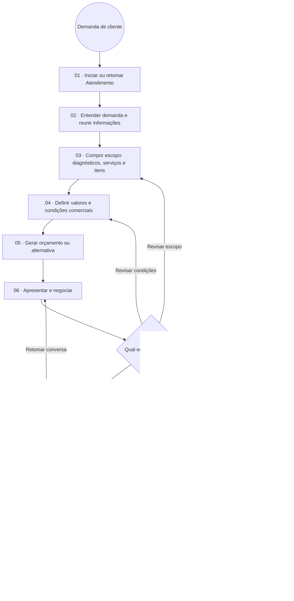
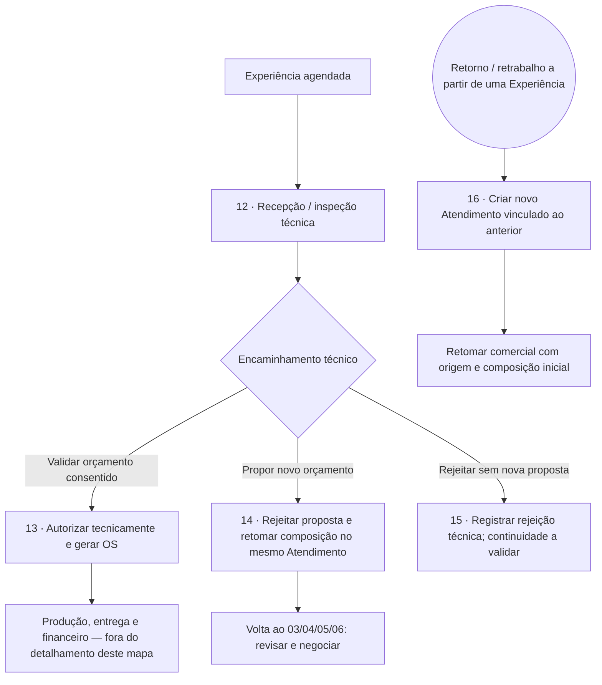

# Mapa geral do Comercial FUNIX — versão 0.1

**Para revisão da direção.** Reconstrução funcional baseada no inventário de metadados, fórmulas e ações do ERP Coda de 21/10/2026. Não é o redesenho futuro aprovado nem uma certificação de execução. Nenhuma alteração produtiva foi feita.

Fonte: documento [Funix no Coda/Superhuman Docs](https://docs.superhuman.com/d/Funix_d2zsjI-nqWr). Evidências locais em `../estudo-comercial-erp/`.

Arquivos para revisão: [mapa em PDF, duas páginas](MAPA_GERAL_COMERCIAL.pdf), [parte A em SVG](mapa-comercial-a.svg) e [parte B em SVG](mapa-comercial-b.svg). Os arquivos `.dot` de mesmo nome permitem regenerar os desenhos com Graphviz. O PDF contém os desenhos; as ressalvas e a rastreabilidade completas estão neste documento.

## Como ler e criticar

Leia primeiro a parte A. Os números identificam assuntos para discussão, não cliques ou status obrigatórios. Atividades arredondadas representam trabalho; losangos, alternativas de encaminhamento; círculos, entrada/saída do recorte. As faixas separam Comercial e Operação. É um mapa de macroprocessos com convenções simplificadas de BPMN, não um modelo BPMN 2.0 executável.

As setas organizam o caminho principal para revisão. Não impõem uma ordem total: coletar informações, negociar, acompanhar e encerrar podem ocorrer em outros momentos. A composição pode conter diagnósticos, serviços e itens conforme o caso; o mapa não estabelece que todos sejam obrigatórios em todo orçamento. O subprocesso de negociação pode lidar com mais de um orçamento.

Para revisar: indicar o número, explicar o que falta/sobra e descrever o resultado esperado. Exemplo: “No 06, às vezes o cliente aceita uma parte e pede mudança em outra; como representamos isso?”. Não é necessário revisar tabelas ou código.

## Parte A — caminho comercial até o agendamento

**Consentimento comercial:** há ação própria `Orçamentos.Aprovar` que registra Consentido, sujeita ao estado do orçamento. Ao concluir o agendamento, o Coda também marca os orçamentos selecionados como Consentido e os não selecionados como Rejeitado. Portanto, o mapa não fixa que o consentimento só aconteça no agendamento nem exige uma aprovação prévia separada como única ordem possível.

**Regra observada no agendamento:** o botão de conclusão exige Cliente, Veículo, Pagador, chegada e pelo menos um orçamento na coleção. Essa coleção inclui todos os orçamentos do Atendimento. A guarda observada não demonstra bloqueio quando nenhum está selecionado. Exigir pelo menos um orçamento efetivamente selecionado/consentido no sistema próprio é uma questão a validar, não uma regra já comprovada pelo controle atual.

O passo 10 não impõe cadastrar tudo no primeiro contato. O resultado do passo 11 é criação/vinculação de Experiência; não é autorização técnica ou geração automática de OS por essa ação de agendamento.

## Parte B — continuidade e voltas entre Comercial e Operação

O bloco 12 agrupa o contexto operacional; a sequência exata de chegada física/inspeção não foi validada em execução. As três saídas representam ações distintas disponíveis, não um gateway universal obrigatório comprovado.

**Revisão após inspeção:** o código atual rejeita o orçamento, apaga/reconstrói os filhos de elaboração do Atendimento a partir da proposta e abre renegociação. O mapa mostra a finalidade comercial dessa volta; não recomenda reproduzir o mecanismo de apagar/reconstruir nem criar outra Experiência. Esse caminho não comprova acréscimos após OS já autorizada.

**Retorno/retrabalho:** a ação auditada cria novo Atendimento com vínculo de origem, precificação Retrabalho e composição inicial. Não reabre automaticamente a Experiência ou OS anterior. A qualificação financeira/operacional desse novo caso requer o subprocesso próprio.

## Recursos transversais e exceções

| Recurso | O que foi observado | Como interpretar no mapa |
|---|---|---|
| Entrada WhatsApp | Workflow n8n publicado consulta/preenche Atendimento Coda, respeitando filtros/preferências e contexto existente | Uma entrada comprovada; não implica criar Atendimento para toda mensagem |
| PDF | Orçamento e filhos fornecem JSON, n8n/Redis/jsreport preparam/renderizam PDF | Recurso de apresentação; gerar PDF não prova envio nem aceite |
| Follow-up | Coda seleciona copies por status; Pack/n8n transporta mensagens | Pode apoiar espera/negociação; ação ativa auditada não avança status |
| Retomada | Campo de retomada existe; interfere na disponibilidade do follow-up | Registrar/programar não comprova disparo automático no horário |
| Encerramento | Ação grava motivo/anotação e muda status do Atendimento | Pode ocorrer antes de gerar orçamento; ramo desenhado após negociação por legibilidade |
| Cancelar orçamento | Ação observada muda estado do orçamento e, quando presente, da OS, com guardas | Diferente de encerrar Atendimento; não implica excluir Experiência, estornar ou reabrir trabalho |
| Reagendamento | Datas programadas são graváveis | Fluxo dedicado e efeitos ainda não comprovados; não foi inventada uma sequência |
| Acréscimo após autorização | Revisão de inspeção não cobre todos os estados posteriores | Subprocesso a investigar e decidir; não presumir aditivo implantado |

Os estados Novo lead, Aguardando dados, Em negociação, Morno e Frio não são tratados como uma sequência obrigatória. Candidaturas profissionais compartilham tabelas/integrações, mas ficam fora deste mapa comercial de clientes.

## Rastreabilidade das atividades

| IDs | Resultado / base da reconstrução | Evidência concreta |
|---|---|---|
| 01–02 | Demanda e contexto comercial em Atendimento; agrupamento funcional para revisão, sem criar uma etapa formal de qualificação | `db_Atendimentos` (`grid-eGvJhrlDTH`); `AUTOMATION_BOUNDARY.md`, entrada WhatsApp |
| 03 | Elaboração parametrizada com relações entre diagnóstico, serviço e item | `CATALOG_PRICING_BOUNDARY.md`; `REDESENHO_DIAGNOSTICO.md` |
| 04 | Precificação, ajustes e condições comerciais | `CATALOG_PRICING_BOUNDARY.md`, catálogos e famílias de cálculo |
| 05 | Cópia de cabeçalho e filhos para orçamento, antes da Experiência | `gerarOrcamento_CriarOrcamento` (`c-wxtscuSYb3`) e geradores de filhos; `HANDOFF_DEPENDENCIES.md`, seção 2 |
| 06 | Apresentação/negociação é agrupamento funcional; aprovação e geração PDF têm ações próprias | `db_Orcamentos.Aprovar` (`c-XnF1ik4UZT`), `pdf_gerarOrcamento` (`c-iQtHw9hpKc`); não comprova canal/envio automático |
| 07 | Acompanhamento e data de retomada; sem avanço de status presumido | `add_Followup` (`c-4taGeBplgf`), `at_programarRetomada` (`c-6K0uD4Qa0x`); `AUTOMATION_BOUNDARY.md` |
| 08 | Encerramento com motivo/anotação | `at_Encerrar` (`c-v00qBLfQJp`), `ux_AtendimentoEncerrar.Encerrar` (`c-Y8aingRLgY`); `schemas.json` |
| 09–11 | Seleção comercial, cadastros e conclusão que cria/vincula Experiência | `at_Agendar` (`c-Pi7uRxxs7X`), `ux_Agendamento.Concluir` (`c-AxrS9QfHHu`), `criar_experiencia` (`c-OP-bvGAi7u`); `HANDOFF_DEPENDENCIES.md`, seção 4 |
| 12–13 | Validação técnica de Consentido, registro de responsável/data, mudança para Autorizado e geração de OS | `inspecao_validacao` (`c-GlR_ht20ib`), `gerarOS_Orquestrador` (`c-n1Sk01JuZv`) |
| 14 | Nova proposta a partir de rejeição técnica e retorno ao mesmo Atendimento | `inspecao_ProporNovoOrcamento` (`c-yTClTXEiGL`); `HANDOFF_DEPENDENCIES.md`, seção 5 |
| 15 | Rejeição técnica distinta de propor novo orçamento | `inspecao_rejeitar` (`c-qd_V1UHNsm`); encaminhamento seguinte não deduzido |
| 16 | Novo Atendimento com origem, não simples reabertura | `Experiencias.ux_RefistrarRetorno` (`c-RPBr29WoN4`), `at_Origem` (`c-qTAnKwg28E`); `HANDOFF_DEPENDENCIES.md`, seção 6 |
| Cancelamento | Estado de orçamento e OS; financeiro não inferido | `db_Orcamentos.Cancelar` (`c-HoP3l0IFG_`); `schemas.json` |

## Pontos para a primeira revisão da direção

1. **Cobertura:** há algum resultado importante do Comercial ausente ou colocado na área errada?
2. **Negociação (06–09):** como funcionam aceite parcial, alternativas e seleção de mais de um orçamento? A regra observada no agendamento deve ser preservada ou reforçada?
3. **Volta da inspeção (14):** o desenho reflete o trabalho real? Quais mudanças após autorização já acontecem por outros caminhos?
4. **Saídas:** o que a equipe faz após rejeição técnica sem nova proposta, cancelamento e pedido de reagendamento?

Essas perguntas validam o processo. Decisões de interface e implementação serão detalhadas por subprocesso, preservando a V20. O mapa não transfere automaticamente responsabilidades do Coda para o aplicativo.

## Limite da evidência

O inventário cobre metadados tabulares de 202 páginas; não certifica todos os processos em execução. Não foram disparados botões, envio de mensagens, geração de documentos ou transações para testar este mapa. Automação interna Coda, controles fora de tabelas e alguns efeitos operacionais permanecem fora da cobertura. Referências não encontradas e metadados ausentes constam em `../estudo-comercial-erp/COVERAGE.md`.

## Registro de revisão

Versão 0.1: aguardando primeira revisão da direção. Nenhuma regra de negócio ou mudança de interface foi aprovada por este documento.
