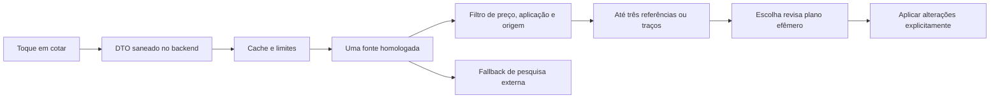

# Issue #67 — investigação de pesquisa de preços de componentes

Data: 06/11/2026 (America/Sao_Paulo). Base analisada: `b3244d1e9638cb683ff727099975a8b370bd81c3`.
Requisitos: [issue #67](https://github.com/Funix-CentroReparacaoAutomotiva/funixapp/issues/67) e [levantamento inicial](https://github.com/Funix-CentroReparacaoAutomotiva/funixapp/issues/67#issuecomment-6692081364).

## Decisão recomendada

**NO-GO para implementar agora a cotação automática com três preços.** Há candidatos públicos reais e canais oficiais relevantes, mas não foi comprovada nesta sessão uma API acessível que entregue preço unitário atual, URL direta, vendedor autorizado e compatibilidade suficiente. **GO para o desenho de fallback manual em um clique**, sujeito à aprovação da direção e a uma PR futura. Falha ou ausência de oferta não pode bloquear orçamento nem significar inexistência no mercado.

Foi executado um experimento de **34 pesquisas sintéticas**, cobrindo **30 pares distintos de veículo/componente**, além de seis pesquisas documentais: **40 buscas no total, abaixo do teto de 50**. Vinte e quatro consultas priorizaram as seis marcas indicadas (quatro por marca), seis avaliaram Peças VW e quatro Mecânico Renault. Quatro consultas VW repetem os pares do Mercado Livre para comparação entre canais. Trata-se de amostra intencional de funilaria/oficina brasileira, não distribuição estatística da frota ou dos atendimentos FUNIX. Sem dados de clientes, criação de conta, nova credencial, contratação, chamadas pagas, escrita comercial, merge ou deploy.

**Limite da conclusão:** o experimento mede descoberta pública de candidatos, não valida o piloto autenticado de Mercado Livre versus Shopping. Esse requisito permanece inconclusivo por falta de credencial autorizada e de acesso apropriado. Não substituir métricas ausentes por números da documentação ou pela velocidade da ferramenta de pesquisa.

## Método e evidências auditáveis

- [AMOSTRA.md](AMOSTRA.md): avaliação por consulta, incluindo incompatibilidades observadas.
- [consultas.json](consultas.json) e [CSV](consultas.csv): texto sintético exato, timestamp UTC, duração, três primeiros candidatos e decisão de não aceitar preço. O SHA-256 identifica o registro bruto usado na análise; páginas completas e dados incidentais de contato não são publicados. Os resultados podem mudar; o hash não permite reconstruir conteúdo não publicado.
- [links.json](links.json): dez verificações adicionais de abertura, das quais cinco são anúncios individuais ML, três produtos VW e dois portais. As seis vitrines também foram abertas separadamente e todas retornaram 403 na ferramenta.
- [mock-local.html](mock-local.html): estudo estático isolado em quadros de 320/390/1440 px; valores explicitamente sintéticos, sem chamadas externas e sem conexão com o app. Não é interface definitiva nem prova de QA de navegador.

As buscas usaram a ferramenta web conectada, com consulta textual a índice público, sem coleta automatizada das páginas das lojas, endpoints privados ou contorno de bloqueios. Não se configura integração nem se presume licença de reutilização comercial porque uma página esteja indexada. Não foram feitas outras buscas de peças fora das Q01–Q34. Aberturas de fontes e documentos não são novas consultas sintéticas; não houve paginação de busca ou repetição autenticada.

O filtro de aceitação exige simultaneamente peça exata, lado/região, geração/ano/versão ou OEM aplicável, condição, unidade/kit, preço total positivo em BRL e condições de pagamento, vendedor/origem verificáveis, disponibilidade e URL HTTPS direta. Para Original nova exige ainda evidência de genuinidade e condição nova por anúncio. Marca no título, palavra “original” e selo de uma loja qualquer não bastam. Para Equilibrada, paralelo qualificado e original usada mantêm natureza e evidências distintas; menor preço sozinho não prova qualidade. Ambiguidade implica `—` ou pergunta técnica breve, nunca inferência.

## Prioridade: as seis vitrines da direção

| Marca e URL fornecida | Consultas | Evidência observada e impedimento |
|---|---|---|
| [Volkswagen](https://www.mercadolivre.com.br/loja/volkswagen) | Q01–Q04 | Índice revela candidatos e parâmetro `official_store_id=1038`; primeira abertura da vitrine 403. Farol de Gol G5 apareceu para Gol 2019; travessa apareceu para cobertura. |
| [Chevrolet](https://www.mercadolivre.com.br/loja/chevrolet) | Q05–Q08 | Candidato de ID 833 em URLs indexadas; 403 da vitrine. Resultados misturam geração de Onix, LED, cupom e subcomponentes. |
| [Fiat](https://www.mercadolivre.com.br/loja/fiat) | Q09–Q12 | Candidato de ID 4637 no índice; 403 da vitrine. Lado errado, presilha de quebra-sol em busca de para-barro e peças inferior/completa. |
| [Hyundai Mobis](https://www.mercadolivre.com.br/loja/hyundai-mobis) | Q13–Q16 | Candidato de ID 260026 no índice; 403 da vitrine. HB20 de gerações distintas, vidro traseiro/fixo e guia em par. |
| [Ford](https://www.mercadolivre.com.br/a/store/ford-loja-oficial) | Q17–Q20 | URL fornecida retornou 403. Índice descobriu `/loja/ford` com candidato de ID 2064; equivalência técnica/redirect não comprovados. [Reparador Ford](https://www.reparadorford.com.br/auto-busca) direciona ao ML e informa encerramento do Auto Busca em 03/10/2022. |
| [Jeep](https://www.mercadolivre.com.br/loja/jeep) | Q21–Q24 | Candidato de ID 2405 no índice; 403 da vitrine. Full LED sem confirmação da versão, flex/diesel, OEM/MPN divergentes e presilha sem aplicação específica confirmada. |

**Esses IDs são pistas extraídas de URLs públicas, não cadastro homologado nem IDs autorizados para uso na integração.** Não houve resolução por API de vendedor/loja ou demonstração de que um token do integrador possa consultar seu catálogo. A consulta textual “loja oficial” prioriza descoberta, mas não restringe resultados à vitrine: anúncios de outros vendedores apareceram e não foram tratados como autorizados. O 403 da ferramenta também não prova impedimento para um usuário humano ou para uma aplicação autorizada.

## Comparação técnica e comercial

| Alternativa | Acesso e dados | Cobertura/latência neste ensaio | Custo e decisão |
|---|---|---|---|
| API oficial Mercado Livre | [Itens e buscas](https://developers.mercadolivre.com.br/pt_br/itens-e-buscas) e [lojas oficiais](https://developers.mercadolivre.com.br/pt_br/loja-oficial) documentam Bearer, itens e identificação de loja. Busca de catálogo de terceiros, permissões e relacionamento vendedor–marca precisam de teste autorizado. | **Zero chamadas autenticadas.** Tentativas de abrir busca MLB pela ferramenta deram “not accessible”, sem resposta HTTP utilizável da API. Documentação aberta diretamente retornou 403; trechos oficiais indexados sustentam apenas capacidade documental. p50/p95 e cobertura da API: N/D. | Tarifa específica de leitura e quotas do nosso caso não comprovadas; não assumir custo zero ou acesso irrestrito. Preferência futura se acesso e qualidade forem demonstrados. |
| SerpApi Shopping | [Shopping](https://serpapi.com/google-shopping-api) e [resultados](https://serpapi.com/shopping-results) oferecem preço numérico e metadados. `product_link` pode ser página Google Shopping, não anúncio do lojista; pode exigir detalhe adicional e outra chamada. `source` não é prova de fornecedor autorizado. | Sem conta/chave ou execução; cobertura Brasil, seller real, precisão e latência N/D. Configuração proposta `gl=br`, `hl=pt`, localização genérica Contagem/MG, sem endereço de cliente. | Plano Free 250/mês; Starter US$25/1.000/mês, reconfirmado. Candidato para próxima prova controlada, sem contratação agora. |
| SerpApi Shopping Light | [Light](https://serpapi.com/google-shopping-light-api) requer `api_key` e reduz resultados enriquecidos. O fornecedor afirma maior velocidade; não há comparação medida aqui. | Não executada. Verificar preço, condição, URL de lojista e perdas de cobertura com a mesma amostra antes de preferi-la. | Mesma tabela geral consultada; consumo e recursos específicos precisam ser confirmados. Não presumir desconto por ser Light. |
| [Peças VW](https://pecas.vw.com.br/quem-somos) | Portal declara venda oficial de peças originais por concessionárias. Produtos públicos incluem OEM, aplicações e faixas por vendedor. API pública/licença de integração não identificadas na inspeção; não equivale a provar inexistência de API B2B. | Q25–Q30; três páginas de produto retornaram conteúdo na ferramenta, com variação entre snapshots. Bom canal humano; nenhum preço unitário de vendedor selecionado homologado. | Sem tarifa pública de consulta comprovada; acesso humano sem cobrança observada. API/feed depende de acordo e autorização. |
| [Mecânico Renault](https://mecanico.renault.com.br/loja-online) | Portal oficial para reparadores, catálogo e ofertas. Páginas de produto informam preço regional por concessionária/CEP; não foi inserido CEP real, cadastro ou pedido. Catálogo Motrio não prova peça genuína Renault em toda aplicação. | Q31–Q34 não entregaram as peças de carroceria solicitadas com preço e URL individual confirmados. Página aberta mostrava zero ofertas, enquanto índice tinha campanhas: não representa todo o estoque. | API pública/feed e tarifa não comprovados. Fallback humano e possível negociação de feed em etapa posterior. |
| Canais institucionais Chevrolet/Ford | [GM genuínas/ACDelco](https://www.chevrolet.com.br/services/maintenance) distingue linhas; [Ford Auto Busca](https://www.reparadorford.com.br/auto-busca) hoje encaminha ao ML. | Verificação documental, sem consultas adicionais de peças ou API homologada; não comparar serviços/revisões com preço de aquisição do componente. | Não contar como novos provedores estruturados independentes. |
| Pesquisa externa manual | Abrir consulta saneada no canal escolhido; resultado precisa de conferência humana. | Usável como saída operacional mesmo quando não há referência aceita; economia de tempo ainda não medida. | Sem tarifa de API para o app; há custo humano. Não prometer três valores ou cotação confirmada. |

Não usar endpoints internos de e-commerce, scraping próprio, credenciais de vendedores ou soluções para vencer 403. O fato de SerpApi ser um fornecedor de API não comprova permissão de cada loja para redistribuir preços: revisar termos de uso, armazenamento, atribuição e finalidade antes de qualquer produção. A proteção jurídica anunciada pelo fornecedor não substitui essa validação.

O levantamento inicial menciona migração de `/items?ids=` para `/items/bulk?ids=`. Não foi possível reconfirmar a página completa nesta sessão; tratar a rota exata, inclusive busca por loja, como pendência de documentação atual e teste, sem copiar um endpoint legado para produção.

## Preços reais observados: exemplos e limites

Valores abaixo vieram de páginas/índice públicos, **não são ofertas recomendadas nem preços homologados para preencher `manualPrice`**.

| Consulta / candidato | Valor observado | Tratamento |
|---|---:|---|
| Q01 [farol 5U0941005](https://produto.mercadolivre.com.br/MLB-2676949813-farol-lado-esquerdo-golsaveiro-g5-original-5u0941005-esquerdo-_JM) | R$1.156,45 no índice | Aplicação anunciada 2009–2011 diverge de Gol 2019; link abriu com 403. Rejeitado. |
| Q02 [travessa Polo](https://www.mercadolivre.com.br/travessa-parachoque-dianteiro-novo-polo-original-volkswagen/up/MLBU768468429) | R$213,90 no índice | Subcomponente diferente da cobertura solicitada; 403. Rejeitado. |
| Q24 [presilha Jeep 51877375](https://produto.mercadolivre.com.br/MLB-5348766071-presilha-fixaco-para-barro-para-choque-jeep-51877375-_JM) | R$84,70; parcela R$8,34 | Preço total é distinto da parcela; aplicação Compass 2018 não confirmada e abertura 403. Pendente. |
| Q25 [farol VW 5U7941007D](https://pecas.vw.com.br/produto/farol-mascara-negra-esquerdo-motorista-vw-5u7941007d/52312) | R$490,00–1.282,61 na abertura | Faixa por vendedores e snapshot antigo da ferramenta; não escolher mínimo como oferta atual. |
| Q26 [para-choque VW 6EA807217FGRU](https://www.pecas.vw.com.br/produto/para-choque-dianteiro-vw-6ea807217fgru/3856) | Índice R$1.367,96–1.821,09; abertura R$1.367,96–2.166,81 | Variação de snapshot, sem vendedor/condições escolhidos. Não usar faixa como preço unitário. |
| Q28 [guia VW 5U0807183B](https://pecas.vw.com.br/produto/suporte-guia-de-para-choque-vw-5u0807183b/1376) | Índice R$0,00/sem estoque; abertura R$11,56–68,61 | Demonstra que zero pode ser sentinela e índice pode estar desatualizado. Lado também exige confirmação. |

Preços em CPF, cupom, Pix, kits, peças avariadas e frete/tributação para CNPJ podem mudar o custo de aquisição da oficina em Contagem. Não incluir frete fictício, somar parcelas, equiparar preço promocional condicionado ao preço geral ou inferir custo posto na oficina. Um CEP genérico da oficina só deve entrar em futura prova se autorizado e tecnicamente necessário.

## Métricas e denominadores

Percentis calculados por nearest-rank: ordenar durações; selecionar posição `ceil(p × n)` (1-based). Duração é relógio do orquestrador envolvendo **uma chamada da ferramenta de busca por consulta**; inclui índice/cache/rede do conector, sem detalhar processamento remoto. Uma observação por consulta, sem aquecimento separado ou carga simultânea; percentis da amostra pequena são exploratórios.

| Grupo | n | p50 ferramenta | p95 ferramenta | p50/p95 API do fornecedor |
|---|---:|---:|---:|---|
| ML, descoberta pública | 24 | 584 ms | 1.194 ms | N/D |
| Portal VW, descoberta pública | 6 | 868 ms | 954 ms | N/D |
| Portal Renault, descoberta pública | 4 | 656 ms | 1.071 ms | N/D |
| Total | 34 | 588 ms | 1.194 ms | N/D |

| Indicador exigido | Resultado e alcance |
|---|---|
| Ofertas úteis aceitas por categoria | Econômica 0/34; Equilibrada 0/34; Original nova 0/34 **neste procedimento conservador de validação**. Não é taxa de cobertura do mercado ou de APIs não executadas. Busca dirigida a originais enviesou a amostra contra as duas primeiras categorias. |
| Frequência de `—` | 34/34 por categoria; 102/102 posições indisponíveis caso o filtro fosse aplicado. A UI de produção não foi implementada. |
| Preços numericamente extraíveis | 34/34 respostas contêm ao menos um token `R$` (até subtotal/campanha de produto errado); **0/34 preços unitários aceitos**. Incidência de token não comprova extração correta nem campo estruturado. |
| Originais corretamente classificados | N/D: nenhum anúncio aceito e nenhum conjunto independente de verdade de origem. Não afirmar 100% de acerto por abstenção. |
| Falsos positivos de compatibilidade | N/D para ofertas aceitas (denominador zero). Há contraexemplos concretos Q01/Q02/Q03/Q11/Q12, suficientes para rejeitar busca textual sem filtro; não houve validação por catálogo OEM independente. |
| Links funcionais | Cinco anúncios ML testados: cinco 403 pela ferramenta; três produtos VW: conteúdo retornado 3/3. Dois portais: conteúdo 2/2. São aberturas assistidas potencialmente cacheadas, **não HTTP 200 atual comprovado**, nem taxa de links de todas as 34 consultas. As seis vitrines: 6/6 403. |
| Volume | 34 buscas sintéticas + 6 documentais; zero chamadas autenticadas ML/Shopping, zero créditos contratados. Aberturas não geram comprovação de consumo faturável por fornecedor. |
| Esforço poupado | N/D: não cronometrou cotador humano nem houve cotação aproveitada. Sem base para alegar retorno financeiro ou ganho de produtividade. |

Não existe comparação controlada de todos os provedores na mesma amostra: somente quatro pares VW foram repetidos em outro canal. Concluir que uma API é mais rápida/barata/abrangente que outra seria extrapolação.

## Custos estimados

[Tabela SerpApi consultada](https://serpapi.com/pricing): Free 250 buscas/mês e 50/h; Starter US$25/mês para 1.000 e 200/h; Developer US$75/5.000; Production US$150/15.000. O fornecedor conta buscas bem-sucedidas, inclusive resultado vazio; informa que cache/erros/falhas não consomem busca. Isso não elimina custo de assinatura ociosa, processamento próprio ou eventuais detalhes cobrados. Confirmar comportamento da engine e plano antes de uso.

Modelo: `chamadas = pesquisas_do_operador × (1 − hit_cache) × chamadas_por_pesquisa`. Uma pesquisa é clique inicial; detalhamento/paginação podem aumentar o multiplicador. Não disparar uma busca para cada uma das seis lojas em todo clique.

| Cenário mensal, 1.000 pesquisas do operador | Chamadas estimadas | Plano que comporta volume na tabela | Custo / 1.000 pesquisas do operador |
|---|---:|---|---:|
| Uma chamada, sem cache | 1.000 | Starter | US$25 |
| Busca + um detalhe em todos os casos, sem cache | 2.000 | Developer | US$75 |
| Seis buscas por clique, sem cache (desaconselhado) | 6.000 | Production | US$150 |
| Uma chamada, cache 40% (hipótese, não medida) | 600 | Starter | US$25 |

Starter a plena utilização equivale a US$0,025/chamada; com apenas 100 consultas pagas no mês, assinatura de US$25 significa US$0,25/consulta efetiva. Em plano gratuito e dentro dos limites, cobrança do fornecedor seria zero; não foi criada conta para utilizá-lo. Os valores são cenários de assinatura inteira, sem contratação, extras ou renovação antecipada. Para reais: multiplicar pelo câmbio efetivamente aplicado e acrescentar impostos/taxas; não se fixou cotação cambial nesta investigação.

API ML e feeds B2B: preço/limite não obtidos, logo **N/D**, não R$0. Portais manuais: nenhuma tarifa de API observada; custo humano `minutos_por_consulta × custo_hora/60`. Hospedagem/cache/observabilidade dependem do ambiente e volume, não provisionados. Reserva preliminar de engenharia, não orçamento aprovado: 2–4 dias úteis para acesso e benchmark autenticado; integração futura mínima 4–8 dias mais QA se a prova passar; manutenção mensal 2–8 h, com incerteza alta em mudanças de catálogo/links. Custo total precisa somar essas horas à assinatura. Não se contratou nenhum serviço.

## Arquitetura mínima proposta — sem implementação

1. **Trigger único:** toque em `receipt-text`, `aria-label="Cotar componente"`. Ditado, mount, edição, reload e Apply não iniciam pesquisa. Validar dados suficientes primeiro; dúvida de geração/versão/lado pede esclarecimento breve ou pesquisa manual.
2. **Backend autenticado:** saneador cria DTO fechado com marca/modelo/ano/versão, nome técnico controlado da peça, lado/região e OEM quando explicitamente conhecidos. Nunca encaminhar texto livre do Atendimento, placa, VIN/chassi, nome, telefone, áudio, transcrição ou IDs comerciais ao provedor. Não usar LLM por padrão. Nome livre atual do componente exige normalização/limitação e bloqueio de PII antes de formar a busca.
3. **Adaptadores substituíveis:** primeiro canal homologado com prioridade das seis lojas; um adaptador por origem, allowlist de vendedores/lojas verificada e versionada com evidência/data. Falta de permissão abre fallback humano; não tenta outro scraper. Shopping pode descobrir candidato, mas não prova origem. No máximo uma pesquisa inicial remota por clique, sem fan-out de seis lojas; etapa de detalhe só sob política orçada e dentro do prazo.
4. **Validador determinístico:** preço decimal exato em string/centavos, moeda, à vista versus parcela, unidade/kit, condição nova/usada/avaria, geração e lado, OEM e procedência. Manter motivo interno de rejeição; não promover categoria sem evidência. Se há range, preço zero sentinela ou URL agregadora, recusar até resolver oferta específica. Original nova só por anúncio validado; Equilibrada distingue original usada de paralelo qualificado.
5. **Contrato proposto:** resposta com `observedAt`, `expiresAt`, `status`, até três referências e fallback. Cada referência aceita inclui categoria, valor decimal, moeda BRL, unidade, URL direta, condição e evidências internas de compatibilidade/procedência. Campo ausente representa `—`, com motivo acessível “não encontrado nesta consulta”; nunca converter ausência em zero. Isso é desenho, sem rota nova neste PR.
6. **Segurança de URL:** HTTPS, host de origem homologado, sem credenciais, `javascript:`, endereços privados ou encurtadores; validar redirects e destino final, proteção SSRF em resolução no servidor, `noopener/noreferrer` na abertura. Página Google Shopping é link de pesquisa até que a URL do lojista seja resolvida legitimamente. Chaves só no backend; não logar tokens/consultas/payloads sensíveis.
7. **Operação proposta:** timeout total inicial de 5 s (meta, não resultado), cancelamento da requisição e resposta tardia descartada por chave de consulta/revisão; cache transitório inicial 10 min (ajustar à licença), chave por DTO normalizado/fonte/região, timestamp e atualização manual. Limites configuráveis iniciais 10 pesquisas/usuário/h e 100/empresa/dia, mais teto global de créditos, sem renovação/cobrança automática. São valores propostos sujeitos a volume e aprovação. Observabilidade agregada de chamadas, latência, erros, abstenção, aceitação e custo; sem consultas ou identificação de cliente em logs.
8. **Encaixe no fluxo existente:** `server/voice-resolution.ts` já revisa quantidade/preço em lote efêmero; `server/voice-apply.ts` é a confirmação transacional. Em PR futura, selecionar referência atualiza apenas o preço-base da prévia e aciona a revisão segura no mesmo clique. Preservar sessão/cenário, digest, expiração, idempotência e invalidação de plano anterior. Se o usuário editar depois ou contexto mudar, resposta atrasada não substitui a edição. Só `Aplicar alterações` grava; nada de chamar Apply ao cotar/selecionar. MR continua exclusivamente no motor, sem margens/frete inventados no frontend.

## Condições para mudar a decisão

Próxima etapa depende de aprovação para obter/usar credenciais, conforme o comentário da direção; esta entrega não solicita contratação nem insere segredos. O teste deverá registrar o resultado real de OAuth/escopos ML e tentativas de busca de terceiros/loja, vendedor, detalhe e links, sem assumir que `/users/{id}/brands` resolva qualquer loja pública. Um token válido que obtenha 403 deve ser registrado como restrição do endpoint/escopo específico, sem generalizar para todas as APIs.

Proposta de gate para a direção, ainda não aprovada: reaproveitar 30 pares com o mesmo conjunto por fonte (limite de consultas da futura rodada definido antes), incluir paralelo qualificado/original usada, revisão técnica independente com catálogo/aplicações e baseline manual cronometrado. Medir p50/p95 fim a fim, chamada extra por link, custo por cotação útil, links e compatibilidade. Metas iniciais: p95 ≤5 s; ≥95% de links diretos válidos entre aceitos; zero falso original/erro crítico de lado ou geração entre aceitos; ≥70% com alguma referência útil; ≥30% de redução mediana do tempo humano; custo total dentro do teto que a direção definir. Cobertura por categoria deve continuar explícita e não exige sempre três referências. Se falhar ou termos/acesso permanecerem incertos, manter fallback manual.

Mesmo zero erro numa amostra de 30 não comprova segurança estatística em produção. QA de permissão, privacidade, respostas tardias e aplicação final continua necessário em PR de integração separada.

## Validação desta entrega

O PR contém somente documentação, evidências reduzidas e mock HTML local. Nenhuma rota, componente React, motor, dependência, banco, migração ou workflow foi modificado. Validação estrutural dos registros/CSV, limite de consultas e caminhos do diff feita localmente. Resultado de `npm run check` consta em `VALIDACAO.md`; não confundir regressão do app existente com teste das APIs. Não foi executada homologação visual em navegador do mock: os quadros têm larguras declaradas e devem ser inspecionados localmente antes de qualquer aprovação visual. A conclusão de acesso limitado está entregue; a comprovação autenticada comparativa permanece pendente e não autoriza implementação definitiva.
